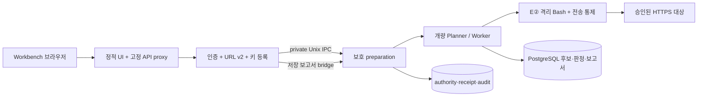

# Workbench URL 진단 제품

루트 `docker compose`는 이 제품 구성을 포함한다. 공식 비교 평가는 기존 루트 `Dockerfile`·`docker-compose.bench.yml`과 [평가 절차](../../docs/evaluation/official-run.md)를 사용한다. 제품 이미지·합성 수용을 공식 baseline·실모델 평가로 계산하지 않는다.

## 최초 설치

Linux Docker Engine 26 이상과 Compose 2.35 이상이 필요하다. UID 1000의 user/PID/mount/net/IPC/UTS namespace 생성이 허용되어야 한다. 준비 서비스의 고정 probe가 실패하면 운영자가 호스트 정책을 확인한다. 호스트 정책을 자동 변경하지 않는다. privileged, SYS_ADMIN, Docker 소켓, host network는 사용하지 않는다.

저장소 밖의 0700 디렉터리에 `install.json`과 임의 PostgreSQL 비밀번호 파일을 0600으로 준비한다. API 키는 설치 JSON에 넣지 않는다. 다음 주소·모델·비밀번호는 실제 승인된 값으로 바꾼다.

```json
{
  "format": "abc2lab.product-install/v2",
  "database_host": "172.31.252.10",
  "database_name": "abc2lab",
  "admin_password": "REPLACE-WITH-A-PRIVATE-ADMIN-PASSWORD",
  "target_policy": {
    "format": "abc2lab.product-target-policy/v1",
    "allowed_ports": [443],
    "max_requests": 4,
    "max_targets": 32
  },
  "valid_for_hours": 24,
  "max_runs": 3,
  "local_model": {
    "model": "operator-approved-model",
    "base_url": "http://192.0.2.30:8080/v1",
    "addresses": ["192.0.2.30"],
    "context_window_k": 128,
    "max_tokens": 2048
  }
}
```

`192.0.2.*`는 문서용 모델 주소다. 실제 승인된 고정 모델 endpoint를 지정한다. OpenRouter만 사용할 때는 `local_model` 대신 아래의 보호된 `openrouter_manifest`를 제공한다.

실행 상한은 선택 블록 `runtime_limits`로 바꿀 수 있다([결정안](../../docs/install-limits-decision.md), C32). 없으면 지금 기본값이다. 모드별로 `product`·`workflow` 칸을 따로 주고, 안의 칸은 모두 선택이다: `request_timeout_ms`(E② 요청 시간, 제품 모드는 프록시 요청 시간도 같이·워크플로 모드는 프록시 요청 시간 그대로), `call_timeout_ms`, `max_calls`(E② 호출과 Worker 도구 호출 상한), `max_attempts`, `worker_turns`, `worker_timeout_ms`, `planner_rounds`, `intent_runs`, `run_seconds`(회차 하나의 실행 시간, 기본 제품 180초·워크플로 600초), `model_concurrency`(동시 모델 호출 수, 기본 1. OpenRouter만 설치하면 그 승인 `max_concurrent` 이하, 로컬 모델이 설치에 있으면 1만), `planner_turns_per_plan`·`planner_seconds_per_plan`(진단 Planner 한 번의 턴 수·시간(초), 기본 16턴·120초. 준비 계획과 실행 계획 모두. 이 상한에 닿은 뒤 원본처럼 마무리 단계가 에이전트 설정의 마무리 턴 수(기본 10턴)까지 더 돌고, 마무리 단계는 시간 상한을 보지 않는다. 실행 시간 상한과 모델 예산은 마무리 단계도 자른다), `status_read_retries`(실행 상태 조회가 연속으로 실패해도 다시 묻는 횟수, 기본 0 = 첫 실패에서 멈춤. 다 쓰면 결과 불명, 상한 200), `max_response_body_bytes`(진단 응답을 도구에 줄 본문 상한, 기본은 요청 본문 상한과 같음 — 제품 16 MiB·워크플로는 대상 정책의 `max_response_bytes`. 상한은 제품 64 MiB, 워크플로는 대상 정책의 `max_response_bytes`. 넘는 응답은 앞부분만 준다), `max_response_scan_bytes`(보호 값 반사를 검사할 만큼 읽는 상한, 기본 응답 상한 + 가장 긴 보호 값 길이, 상한 65 MiB. 주면 응답 상한 이상이어야 하고, 보호 값이 있으면 응답 상한 + 가장 긴 보호 값 길이 − 1 이상이어야 한다). 상한은 코드가 정한 검사 상한(요청 시간 60초, Worker 턴·도구 호출 1000, Worker 시간 1시간, Planner 라운드 100, intent 실행 10, 실행 시간 600초, Plan당 턴 1000·시간 3600초 등)이고, 범위 밖·0 이하(밀리초 값이 시간으로 바꿀 때 넘치는 값 포함)는 설치 전에 거부한다. 값은 E② 정책 파일(정책 지문)이나 설치 기록의 회차 예산(`run_seconds`, 회차 승인 범위에도 남음), launch 설정(`model_concurrency`·Plan당 상한·`status_read_retries`, 설치 기록 해시)에 묶인다. 예: `"runtime_limits": {"product": {"worker_turns": 16, "planner_rounds": 12}}`. 바꾸려면 설치 갱신(`./update.sh`)으로 한다.

**설치에는 진단 대상 origin·IP·경로가 없다.** `target_policy`는 엔진이 사용할 보안 환경의 상한이며 대상 승인이 아니다. 기본은 공개 IP·HTTPS 443만 허용한다. 운영자는 별도 검토한 온프레미스 환경에서만 좁은 `private_cidrs`(IPv4 /24 이상·IPv6 /64 이상)와 포트를 설치할 수 있다. UI는 이 보안 환경을 넓힐 수 없다. loopback·link-local·메타데이터·예약 주소는 예외 CIDR로도 허용하지 않는다. 새 진단 URL 등록에는 재설치나 이 JSON 수정이 필요 없다.

```bash
export PRODUCT_SOURCE_SHA="$(git rev-parse HEAD)"
export PRODUCT_INSTALL_FILE=/srv/abc2lab-install/install.json
export PRODUCT_POSTGRES_PASSWORD_FILE=/srv/abc2lab-install/postgres-password
docker compose build
docker compose up -d --wait
```

Workbench는 `http://127.0.0.1:8787/`, 사용자명은 `ABC2LAB`, 비밀번호는 설치 입력의 값이다. 원격 접근은 운영자의 HTTPS 역방향 프록시로 제공한다. 기본 loopback 바인딩을 평문 LAN에 공개하지 않는다.

로그인 이름은 `ABC2LAB`이다. 기존 설치의 비밀번호와 저장된 진단을 그대로 사용하도록 JWT subject·승인 정책의 내부 관리자 식별자 `ARTEX`는 유지한다. 이전 로그인 이름 `ARTEX`는 받지 않는다.

`./install.sh`는 같은 환경변수로 구성 검사·제품 소스 build·`up -d --wait`를 실행한다. `./update.sh`는 검토한 소스에서 같은 절차로 기존 설치를 검증·재사용하며 데이터/예산을 초기화하거나 설치 형식을 자동 이관하지 않는다. 비밀번호 복구는 같은 환경변수로 `./reset-password.sh`를 실행해 숨김 입력한다.

설치자는 빈 전용 DB, 최소 권한 역할, 로그인 해시·JWT 키, E② CA·감사 키·helper pin, 대상 보안 상한·모델 정책, 위임·private IPC를 생성한다. 설치와 헬스체크는 모델 completion·대상 HTTP를 호출하지 않는다. 재기동은 기존 installation을 검증하고 재사용한다. API는 `product-state`의 `api` 하위 경로와 private IPC만 읽기 전용으로 마운트한다. 투영에는 API launch·설치 메타데이터·모델 launch·JWT·API 및 model-writer DSN만 있으며 CA 개인키·HMAC 감사 키·runtime DSN·실행 저널은 없다. 기존 설치도 installer 재실행 시 원본을 검증해 투영을 생성하며, 불일치한 기존 투영은 덮어쓰지 않는다. [Compose의 volume.subpath](https://docs.docker.com/reference/compose-file/services/#volumes)를 사용한다. 부분 실패의 `.installing`은 자동 삭제하지 않는다. 사용하지 않은 전용 설치인지 운영자가 확인한 뒤 새 볼륨으로 다시 설치한다.

## 사용 흐름과 외부 LLM

**새 점검 → URL 입력 → 외부 LLM 사용하기 → 승인 모델 선택·API 키 등록/재사용 → 대상 권한·범위 등록 및 소유 확인 → 서버 승인 범위·비용 확인 → 명시적 동의 → 진단 시작.** 로컬 승인 프로필이 하나면 기본 선택한다. 키 저장과 범위 확인만으로 진단을 실행하지 않는다.

OpenRouter는 운영자가 `openrouter_manifest`에 [기존 보호 승인 JSON 형식](../../docs/openrouter-first-diagnosis.md)을 추가한다. `local_model`은 생략할 수 있다. 현재 모델은 `qwen/qwen3.5-35b-a3b`, endpoint는 `https://openrouter.ai/api/v1`로 고정된다. installer가 profile ID를 생성된 DB ID에 바인딩한다. provider slug/응답 이름, privacy/ZDR, 계정 spend cap, 요청·토큰·실제 USD 상한, 가격 상한, 만료·승인 ID를 운영자가 확인한다. 키 입력으로 이 설정을 바꿀 수 없다.

키는 인증된 `POST /api/product/model-credentials`에서 설치된 프로필의 `api_key` 열만 갱신한다. 별도 writer 역할에는 키 읽기·모델·endpoint·예산 변경 권한이 없다. 비제어 password 입력은 전송 즉시 비우며 React 상태·URL·진단 초안·local/session storage·보고서에 키를 넣지 않는다. 시작 시 외부 전송·비용 동의는 별도로 필요하다. 키 변경·응답 유실·사용량 불명은 기존 fail-closed 계약을 따른다. 다음 진단은 인증된 GET에서 `configured`와 승인 모델 ID만 읽어 키를 재사용한다. API 키 값은 브라우저로 반환하지 않는다. 연결 실패 시 합성 모델이나 일반 ARTEX 엔진으로 자동 전환하지 않는다.

유료 승인(OpenRouter manifest)은 승인 총량·만료 안에서 여러 회차가 이어 쓴다. 승인 ID마다 보호 manifest 디렉터리에 누적 예약 기록(`.openrouter-<승인 해시>.ledger`)을 두고, 매 요청 전에 잠금 안에서 다시 읽어 승인 총량을 넘지 않을 때만 예약한다(P3 결정안 C07, `docs/openrouter-first-diagnosis.md`). 한도·만료·누적 예산 소진 후에는 기존 운영자 재승인이 필요하다. 예전 1회용 표식(`.used`)·`.ledger`·journal을 지우거나 고쳐 재승인하지 않는다. `.ledger`를 지우면 그 승인의 누적 합계가 0으로 돌아가 총량 보장이 깨진다. 사용자 모델 입력은 설치된 승인 모델에 한정된다.

## 탐색·선택 워크플로 설치

새 설치에서만 `target_policy.max_requests`와 선택적인 `target_policy.workflow`를 함께 지정한다. 아래 설정은 회차 HTTP 상한 64, 초기 탐색 최대 8페이지, 발견 최대 32개다.

탐색 경계·브라우저 샌드박스를 띄운 설치는 `target_policy.exploration` 블록을 넣는다([탐색 경계·브라우저 샌드박스](#탐색-경계브라우저-샌드박스설치-조직이-켬)). 없으면 탐색은 `NOT_RUN`이고 E② 정적 크롤만 쓴다.

```json
{
  "max_requests": 64,
  "workflow": {
    "format": "abc2lab.workbench-flow/v1",
    "max_pages": 8,
    "max_endpoints": 32,
    "max_response_bytes": 2097152,
    "allow_reversible_writes": true
  }
}
```

Workbench에서 AI 자동 또는 사용자 승인 모드를 고른다. 두 모드 모두 보호 Worker의 E② Bash 경로로 초기 정적 탐색을 수행한다. 사용자 승인 모드는 저장된 발견 중 선택한 메서드·경로만 심화 검사하며, 설치 상한과 대상 등록에서 별도로 동의한 복구 가능한 상태 변경만 요청별 확인으로 보낸다. 자동 모드는 GET/HEAD 읽기 범위만 사용한다. GET 폼은 별도 확인 대상이며, 정적 문자열에서 HTTP 메서드를 확인하지 못하면 `UNKNOWN`으로 남겨 자동 방문·선택하지 않는다. 동적 SPA 전체 탐색과 대상 로그인 A/B 연결은 지원하지 않는다.

상태 변경 본문은 최대 64KiB다. 개별 확인 기한은 도구·회차 기한과 proxy 1분 상한 중 빠른 값이며 화면에 실제 만료를 표시한다. 일시정지로 기한이나 예산을 연장하지 않는다. 초기 탐색·선택·명령 영수증은 PostgreSQL에 저장한다. 결과 불명 뒤 자동 재전송·예약 환불·재실행은 하지 않는다. 새 입력별 파생 설정은 최대 512개까지 보존하며 자동 삭제하지 않는다.

이 설정은 기존 유료 모델의 요청·토큰·USD 승인 한도를 늘리지 않는다. 새 워크플로는 충분한 모델 예산을 운영자가 사전 승인한 환경에서 사용한다. 기존 설치의 보호 파일을 편집하거나 자동 이관하지 않는다. 자세한 API·정책 제안은 [워크플로 계약](../../docs/contracts/workbench-engine-workflow.md)을 참조한다.

## 새 대상 등록·승인

1. Workbench에서 HTTPS URL, 명시적인 읽기 전용 경로, 운영자의 진단 권한과 해당 GET/HEAD의 비변경 승인 근거를 입력한다. 요청 상한은 기본 회차당 4회, 승인 유효 기간은 4시간이다. GET/HEAD라는 이유만으로 안전하다고 승인하지 않는다.
2. **대상 등록·소유 확인 준비**는 pending 기록과 임의 DNS TXT challenge만 만든다. 실행 권한은 발행하지 않는다. 현재 단일 관리자(`ABC2LAB`, 내부 subject `ARTEX`)만 등록·승인할 수 있다.
3. 표시된 `_abc2lab-challenge.<호스트>` 이름·값을 대상 DNS 운영 화면에 등록하고 **소유 확인 후 대상 승인**을 누른다. 서버가 TXT 소유 증명, 모든 DNS 주소, 설치 상한, 포트, 검증된 TLS 인증서와 leaf SPKI를 확인한다. 이 확인은 TLS handshake이며 대상 HTTP 진단을 실행하지 않는다. IP literal 대상은 초기 범위에서 지원하지 않는다.
4. 서버의 범위 확인 화면에서 경로·메서드·요청/모델/토큰/USD 예산과 외부 전송을 검토하고 명시적으로 시작한다. 범위 확인과 재조회는 DNS·대상 HTTP·모델을 호출하지 않는다. **시작 직전** 소유 증명·DNS 주소 집합·TLS 공개키·만료·철회를 재검증한 뒤 개량 Planner/Worker를 실행한다.

대상 승인 권한 모델은 #353에서 분리한 [후속 제안](../../docs/contracts/product-target-approval-proposal.md)이며 팀 합의 전이다. 승인 시 정상 TLS 1회(후보 주소 실패 시 최대 8회), 시작 직전 선택 IP에 TLS 1회를 수행한다. 각 접촉의 시도·결과는 `state/targets/tls-contacts` 보호 저널에 기록하고 기록 실패 시 차단한다. 대상 HTTP 0과 무접촉을 혼용하지 않는다.

승인은 보호된 `state/targets` journal에 영속화된다. 매 회차는 독립 target/scope 참조와 정확한 origin/IP/port/path/method/TLS pin을 갖는다. DNS 주소 집합이 바뀌면 새 진단은 시작되지 않으며, 실제 연결도 승인 IP로만 전송하고 TLS pin을 다시 검사한다. 리다이렉트는 자동 추적하지 않는다. 다른 등록 대상의 승인을 빌려 쓰지 않는다.

승인 철회는 해당 대상의 신규 실행을 막고 진행 중인 해당 대상의 context만 취소한다. 회차별 마감·불명 처리는 기존 계약을 따른다. 저장 보고서는 당시 target 참조의 승인 기록을 사용하므로 새 URL 등록이나 철회로 다른 회차의 범위를 바꾸지 않는다. 만료·DNS/TLS 변경 후에는 새 승인이 필요하다. 초기 등록 수 상한은 설치당 32개이며 기록 삭제·재설정으로 권한을 복구하지 않는다.

설치 v2는 새 제품 설치 형식이다. 기존 v1 고정 대상 설치의 저장 보고서/독립 CLI 계약은 유지하지만 자동 변환하지 않는다. v1→v2 데이터 이관은 운영자 검토가 필요한 별도 작업이다.

## 실행 경계와 영속 상태



workbench에는 DB·키·제품 상태 볼륨이 없다. preparation netns 안의 TCP 리슨은 preparation·api가 127.0.0.1, workbench가 frontend 망 고정 주소(`172.31.250.12:8787`)뿐이라 모든 인터페이스에 열린 포트가 없다(엔진이 탐색 제어망에 붙어도 그 망에 포트가 열리지 않게 하려는 조건, 계약 §9-1). 호스트 쪽 공개는 그대로 `127.0.0.1:8787`이다. api는 상태 볼륨을 읽기 전용으로 사용한다. preparation만 회차와 영속 상태를 쓴다. 세 서비스는 기존 loopback API 계약 때문에 preparation의 network namespace만 공유한다. PID·capability·rootfs는 분리한다. PostgreSQL과 시험 대상은 내부 control/target 망에 있으며 DB 포트를 공개하지 않는다. 외부 모델 연결은 명시적으로 설치된 보호 정책만 허용한다.

런타임은 UID 1000, read-only rootfs, cap_drop ALL, no-new-privileges다. [준비 서비스 seccomp](seccomp-preparation.json)는 [Docker 기본 정책](https://docs.docker.com/engine/security/seccomp/)의 deny 기본값에 필요한 namespace 조합과 내부 mount·pivot만 추가한다. 원본 Moby profiles commit은 `4b8214fc4971e06172938a1f1554ccff6647ee80`; [라이선스](seccomp-preparation.LICENSE)를 포함한다. Bash helper의 기존 capability 제거·추가 seccomp·네트워크 격리는 유지한다. AppArmor가 별도로 막는 호스트에서는 운영자의 정책 검토가 필요하다.

`postgres-data`(DB)와 `product-state`(키·정책·authority·receipt·audit)를 함께 백업하고 권한을 보존한다. `target-tls`는 소유 시험 전용이다. 재기동은 `docker compose down` 후 `docker compose up -d --wait`로 수행한다. `down -v`는 영속 상태를 삭제하므로 복구 절차에 사용하지 않는다. 실행 중 강제 종료는 unknown으로 남으며 자동 재실행하지 않는다. 완료된 회차는 재기동 후 저장 보고서로 조회한다.

### 탐색 경계·브라우저 샌드박스(설치 조직이 켬)

기본 설치는 탐색을 켜지 않는다(탐색 `NOT_RUN`, E② 정적 크롤만). 켜려면 `--profile exploration`으로 아래 네 서비스를 같이 띄우고 설치 입력에 `target_policy.exploration`을 넣는다.

- `explore-init`(한 번 실행): 운영자 보호 입력(root 0600) 네 개를 받아 경계 전용 볼륨(`explore-boundary-input`, uid 1001·0600)과 공개 CA 볼륨(`explore-ca`, 0644)으로 나눈다. 네트워크 없음.
- `explore-boundary`(uid 1001): 브라우저 입구 `172.31.248.10:3128`(`explore_browser_ingress`)과 직접 입구 `172.31.247.10:3129`(`explore_direct`)에만 리슨하고, 승인 대상에는 `target`·`frontend` 망으로 나간다. 제어 소켓은 `explore-control` 볼륨에 만들고 엔진 그룹(1000) 0660으로 넘긴다(비root 컨테이너는 소유자를 바꿀 능력이 없다). 접속은 엔진 uid(1000)의 `SO_PEERCRED`로만 받는다. 엔진(`preparation`)은 같은 볼륨으로 제어 소켓에, `explore_direct`로 직접 입구에 닿는다.
- `explore-browser`·`explore-mcp`: 아래 설명.

보호 입력(저장소 밖, root 소유 0600):

```bash
D=/srv/abc2lab-explore; sudo install -d -m 0700 "$D"
sudo openssl req -x509 -newkey ec -pkeyopt ec_paramgen_curve:P-256 -nodes -days 365 -subj '/CN=JinDo explore boundary CA' \
  -addext basicConstraints=critical,CA:TRUE -addext keyUsage=critical,keyCertSign -keyout "$D/ca.key" -out "$D/ca.pem"
sudo sh -c "head -c 32 /dev/urandom > '$D/path.key'"
sudo cp deploy/product/explore-boundary.example.json "$D/boundary.json"   # 주소·상한을 설치에 맞게 고친다
sudo chmod 0600 "$D"/*
export EXPLORE_BOUNDARY_CONFIG_FILE=$D/boundary.json EXPLORE_CA_CERT_FILE=$D/ca.pem EXPLORE_CA_KEY_FILE=$D/ca.key EXPLORE_PATH_KEY_FILE=$D/path.key
```

설치 입력에는 다음 블록을 넣는다(`boundary_ca_file`은 installer 안의 경로다. installer 진입점이 `EXPLORE_CA_CERT_FILE`을 이 경로로 옮기고, 설치기가 설치 디렉터리로 복사해 SHA-256을 고정한다).

```json
"target_policy": { "exploration": {
  "control_socket": "/run/explore-control/control.sock",
  "direct_proxy": "http://explore-direct:3129",
  "boundary_ca_file": "/tmp/product-private/explore-ca.pem",
  "mcp_url": "http://explore-mcp:8931/mcp" } }
```

`max_external_requests`(선택, 0~4096)는 외부 통신 승인 모드에서만 쓰는 렌더링용 외부 자원 GET 상한이다. `direct_bash`(선택, 기본 꺼짐)를 `true`로 두면 탐색 에이전트에 원본처럼 Bash 도구를 준다(C30). 명령은 진단 Bash와 같은 격리 실행(`/app/e2-bash-sandbox`, 빈 network namespace) 안에서 돌고 나가는 길은 경계의 직접 입구 하나라서, 승인 범위·쓰기 승인·탐색 요청 예산·기록을 경계가 그대로 적용한다(명령 하나 2분, 출력 32 KiB). 엔진 컨테이너가 진단 Bash 샌드박스를 띄울 수 있어야 하고(설치 사전 검사와 같은 조건), 띄우지 못하면 그 회차는 Bash 없이 탐색한다. 경계 설정의 `control_endpoints`는 경계가 대상으로도 연결하지 않을 내부 주소(DB·엔진·MCP·CDP·경계 자신)다. 예시는 이 compose의 고정 주소를 그대로 넣었다. 경계 응답 상한(`max_response_bytes`)은 브라우저가 받는 번들까지 넣을 수 있게 크게 잡았다.

`explore-browser`(Chromium)와 `explore-mcp`(Playwright MCP)는 [탐색 계약](../../docs/contracts/exploration-boundary.md) §9-1 분리 배치의 브라우저 샌드박스다. 같은 이미지(Chromium과 `@playwright/mcp@0.0.84`만 들어 있고 엔진 바이너리·제어 비밀·보호 볼륨은 없음)를 다른 진입점으로 쓴다. Chromium은 브라우저 입구망(`explore_browser_ingress`)과 CDP 연결망(`explore_cdp`)에만, MCP는 제어망(`explore_control`)과 CDP 연결망에만 붙는다. 같은 namespace의 native 자식이 MCP 제어 포트에 닿던 B16을 배치로 막기 위해서다. `--profile exploration`을 줄 때만 렌더링된다. CA 파일(`explore-ca` 볼륨, `explore-init`이 씀)이 없으면 Chromium이 시작하지 않는다. MCP 옵션은 compose가 정하고(`--host`·`--port`·`--allowed-hosts`는 한 묶음, `--cdp-endpoint`는 Chromium의 `--cdp-listen` 주소), 모델에 노출하는 도구는 서버의 고정 목록(`server/mcp_tool_policy.go`)으로 거른다. Chromium 157은 `--remote-debugging-address`를 무시하고 CDP를 loopback에만 열므로, Chromium 실행기(`explore-chromium.js`)가 CDP 연결망 주소 하나에만 리슨하는 TCP 중계를 둔다. 구성 조건은 `scripts/ci/test_product_explore_browser.py`가 렌더링으로 확인한다.

## 화면별 실제 API

| 화면 | 연결 |
|---|---|
| 로그인 | `/api/auth/status`, `/api/auth/login` |
| 대시보드 | URL v2 catalog·현재 receipt/status. 전체 이력 미제공 안내 |
| 새 점검 | `/api/diagnoses/v2/catalog`, `.../drafts`, `/api/product/targets`, `/api/product/model-credentials` |
| 자산 탐색 | 현재 진단의 서버 승인 scope. 별도 인벤토리·자동 크롤링 미지원 안내 |
| 범위 확인 | URL v2 validate·scope·budget·명시적 start |
| 점검 진행 | URL v2 status/receipt·stop, 실제 task request-approvals |
| 보고서 | 저장 run·remediation·HTML download bridge |

404/501·조회 실패·unknown은 실행을 막는다. 일반 `POST /api/tasks`로 전환하지 않는다. 일반 HTTP 관찰은 검토 후보이며 지원되는 E③ 판정이 없으면 확정 취약점으로 표시하지 않는다.

## 소유 로컬 Docker 수용

`compose.acceptance.yaml`은 시험 overlay다. Juice Shop **v15.0.0**(digest `fe8cecfec60f7856a02b52072c879b1baf73f5a97faafdeb12ed9e8eaccc0c3d`), HTTPS front, 합성 OpenAI 호환 모델만 추가한다. 제품의 개량 엔진·URL v2·E②·DB·보고서는 실제 경로다.

수용 설치 v2는 대상 origin/IP/path 없이 `target_policy.private_cidrs: ["172.31.253.0/24"]`, `allowed_ports: [9443]`, 시험 resolver `172.31.252.40:5353`, `upstream_ca_file: "/target-tls/ca.pem"`와 로컬 모델 `http://172.31.252.30:8080/v1`만 준비한다. fixture-init은 소유 시험 CA·두 HTTPS front 인증서·DNS 제어 토큰을 전용 볼륨에 생성한다. 제품 installer는 시험 인증서나 대상 승인을 만들지 않는다.

Workbench에서 `https://juice-a.test:9443/rest/products`, `https://juice-b.test:9443/rest/products`를 각각 등록한다. 보호된 DNS 제어 토큰으로 시험 DNS에 challenge를 게시한 뒤 UI 승인·별도 진단을 진행한다. 각 Worker는 허용 상품 경로를 읽고, 다른 승인 대상에 대한 송신이 거부되는지 시도한다. 기존 `juice.test` 단일 대상 fixture/응답 유실·저장 보고서 시험 경로도 유지한다. 내부망 CIDR이 호스트와 충돌하면 운영자가 시험 overlay의 주소를 함께 조정한다.

```bash
docker compose -f deploy/product/compose.yaml -f deploy/product/compose.acceptance.yaml build
docker compose -f deploy/product/compose.yaml -f deploy/product/compose.acceptance.yaml up -d --wait
```

모델 통계는 loopback 49082 `/stats`, 대상 A/B 통계는 각각 49081/49084 `/stats`, 소유 DNS 제어는 49083 `/control`이다. DNS 제어 토큰은 시험 전용 보호 파일에서만 읽는다. 대상 readiness는 TCP만 확인한다. `scripts/product-diagnosis-browser.cjs`는 별도 Chrome CDP와 보호된 합성 설치 입력을 사용해 실제 root Workbench를 조작한다. 시작 응답 유실 시험은 실제 서버가 수락한 응답만 버린다. 모델·진단 응답을 브라우저에서 위조하지 않는다. 실모델 수용은 실제 USD 승인과 운영 키가 별도로 준비된 뒤 수행한다.

두 URL의 실제 승인·격리·키 재사용·보고서 및 미실행 Qwen 구분은 [제품 v2 수용 기록](../../docs/product-targets-v2-acceptance.md)을 따른다.

### 탐색·선택·요청 승인 종단 시험

선택적인 workflow를 켠 제품은 [워크플로 계약](../../docs/contracts/workbench-engine-workflow.md)과 [실측 수용 기록](../../docs/workbench-workflow-acceptance.md)을 따른다. 위 화면 API 표는 workflow 미설치 경로다. 설치한 경우 자산 탐색·선택·요청 승인·보고서를 실제 workflow API에 연결한다.

소유 일회용 환경에서 `compose.workflow-acceptance.yaml`을 세 번째 overlay로 추가하면 모델은 `workflow-model`, A/B front는 `workflow-target` 역할을 사용한다. `/workflow`는 시험용 HTML 탐색 페이지이고 실제 상품·버전·계정 생성은 뒤의 Juice Shop에 전달한다. 모델 id는 설치 JSON에 `owned-synthetic-workflow`로 명시한다. 유료 모델 수용에 사용하지 않는다.

```bash
docker compose -f deploy/product/compose.yaml -f deploy/product/compose.acceptance.yaml -f deploy/product/compose.workflow-acceptance.yaml build
docker compose -f deploy/product/compose.yaml -f deploy/product/compose.acceptance.yaml -f deploy/product/compose.workflow-acceptance.yaml up -d --no-build --wait
```

브라우저 시험의 기본 포트는 제품18887, A/B 통계49481/49484, 모델49482, DNS제어49483, 별도 소유 Chrome CDP49439다. Compose의 `PRODUCT_PORT`, `PRODUCT_TARGET_STATS_PORT`, `PRODUCT_TARGET_B_STATS_PORT`, `PRODUCT_MODEL_STATS_PORT`, `PRODUCT_DNS_CONTROL_PORT`를 이에 맞춘다. 호스트의 다른 내부망과 충돌하면 기존 시험 안내대로 네트워크 주소와 설치 JSON의 CIDR/resolver/model 주소를 함께 바꾼다.

fixture-init이 만든 새 `/target-tls/control-token`을 stdout에 노출하지 않고 mode0600의 전용 파일로 복사한다. `scripts/workbench-workflow-browser.cjs <manual|auto|stop|recover|design> <private-install.json> <private-dns-token> <output-dir>` 순서로 실제 브라우저를 조작한다. Chrome CDP와 스크립트는 같은 loopback 환경에서 연결해야 한다. 이번 기록은 Windows Chrome157·Node22를 사용했다. 상태·실행 결과를 브라우저 내부 store에 주입하지 않는다.

동일 이미지·볼륨 재시작은 `stop workbench api preparation postgres` 뒤 같은 Compose의 `up -d --no-build --wait postgres preparation api workbench`로 확인한다. 설치 당시와 helper 지문이 다른 이미지는 기존 pin 검사에서 거절된다. 보호 파일을 고치거나 unknown 저널·예산 예약을 지워 이미지 변경을 우회하지 않는다. 이미지 교체·설치 세대 마이그레이션은 별도 검토가 필요하다.

비밀번호 재설정은 실행 중인 Workbench의 `product-password-hash`가 stdin으로 받은 비밀번호를 Go bcrypt로 해시하고 PostgreSQL에는 해시만 전달한다. `pgcrypto` 확장이나 스키마를 추가하지 않는다. 새 비밀번호는 12~72 bytes이며 명령행·컨테이너 환경변수·파일에 원문을 넣지 않는다. 공통 Compose 진입점은 설치 입력의 실제 경로가 저장소 밖이고 파일 권한이 0600인지 확인한 뒤 Docker를 호출한다.
