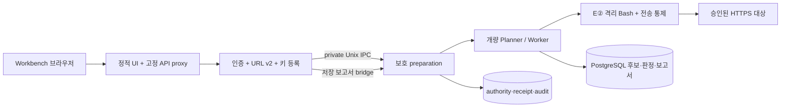

# Workbench URL 진단 제품

루트 `docker compose`는 이 제품 구성을 포함한다. 공식 비교 평가는 기존 루트 `Dockerfile`·`docker-compose.bench.yml`과 [평가 절차](../../docs/evaluation/official-run.md)를 사용한다. 제품 이미지·합성 수용을 공식 baseline·실모델 평가로 계산하지 않는다.

## 최초 설치

Linux Docker Engine과 Compose 2.20 이상이 필요하다. UID 1000의 user/PID/mount/net/IPC/UTS namespace 생성이 허용되어야 한다. 준비 서비스의 고정 probe가 실패하면 운영자가 호스트 정책을 확인한다. 호스트 정책을 자동 변경하지 않는다. privileged, SYS_ADMIN, Docker 소켓, host network는 사용하지 않는다.

저장소 밖의 0700 디렉터리에 `install.json`과 임의 PostgreSQL 비밀번호 파일을 0600으로 준비한다. API 키는 설치 JSON에 넣지 않는다. 다음 주소·모델·비밀번호는 실제 승인된 값으로 바꾼다.

```json
{
  "format": "abc2lab.product-install/v2",
  "database_host": "172.31.252.10",
  "database_name": "abc2lab",
  "admin_password": "REPLACE-WITH-A-PRIVATE-ADMIN-PASSWORD",
  "target_policy": {
    "format": "abc2lab.product-target-policy/v1",
    "allowed_ports": [443],
    "max_requests": 4,
    "max_targets": 32
  },
  "valid_for_hours": 24,
  "max_runs": 3,
  "local_model": {
    "model": "operator-approved-model",
    "base_url": "http://192.0.2.30:8080/v1",
    "addresses": ["192.0.2.30"],
    "context_window_k": 128,
    "max_tokens": 2048
  }
}
```

`192.0.2.*`는 문서용 모델 주소다. 실제 승인된 고정 모델 endpoint를 지정한다. OpenRouter만 사용할 때는 `local_model` 대신 아래의 보호된 `openrouter_manifest`를 제공한다.

**설치에는 진단 대상 origin·IP·경로가 없다.** `target_policy`는 엔진이 사용할 보안 환경의 상한이며 대상 승인이 아니다. 기본은 공개 IP·HTTPS 443만 허용한다. 운영자는 별도 검토한 온프레미스 환경에서만 좁은 `private_cidrs`(IPv4 /24 이상·IPv6 /64 이상)와 포트를 설치할 수 있다. UI는 이 보안 환경을 넓힐 수 없다. loopback·link-local·메타데이터·예약 주소는 예외 CIDR로도 허용하지 않는다. 새 진단 URL 등록에는 재설치나 이 JSON 수정이 필요 없다.

```bash
export PRODUCT_SOURCE_SHA="$(git rev-parse HEAD)"
export PRODUCT_INSTALL_FILE=/srv/abc2lab-install/install.json
export PRODUCT_POSTGRES_PASSWORD_FILE=/srv/abc2lab-install/postgres-password
docker compose build
docker compose up -d --wait
```

Workbench는 `http://127.0.0.1:8787/`, 사용자명은 `ABC2LAB`, 비밀번호는 설치 입력의 값이다. 원격 접근은 운영자의 HTTPS 역방향 프록시로 제공한다. 기본 loopback 바인딩을 평문 LAN에 공개하지 않는다.

로그인 이름은 `ABC2LAB`이다. 기존 설치의 비밀번호와 저장된 진단을 그대로 사용하도록 JWT subject·승인 정책의 내부 관리자 식별자 `ARTEX`는 유지한다. 이전 로그인 이름 `ARTEX`는 받지 않는다.

설치자는 빈 전용 DB, 최소 권한 역할, 로그인 해시·JWT 키, E② CA·감사 키·helper pin, 대상 보안 상한·모델 정책, 위임·private IPC를 생성한다. 설치와 헬스체크는 모델 completion·대상 HTTP를 호출하지 않는다. 재기동은 기존 installation을 검증하고 재사용한다. 부분 실패의 `.installing`은 자동 삭제하지 않는다. 사용하지 않은 전용 설치인지 운영자가 확인한 뒤 새 볼륨으로 다시 설치한다.

## 사용 흐름과 외부 LLM

**새 점검 → URL 입력 → 외부 LLM 사용하기 → 승인 모델 선택·API 키 등록/재사용 → 대상 권한·범위 등록 및 소유 확인 → 서버 승인 범위·비용 확인 → 명시적 동의 → 진단 시작.** 로컬 승인 프로필이 하나면 기본 선택한다. 키 저장과 범위 확인만으로 진단을 실행하지 않는다.

OpenRouter는 운영자가 `openrouter_manifest`에 [기존 보호 승인 JSON 형식](../../docs/openrouter-first-diagnosis.md)을 추가한다. `local_model`은 생략할 수 있다. 현재 모델은 `qwen/qwen3.5-35b-a3b`, endpoint는 `https://openrouter.ai/api/v1`로 고정된다. installer가 profile ID를 생성된 DB ID에 바인딩한다. provider slug/응답 이름, privacy/ZDR, 계정 spend cap, 요청·토큰·실제 USD 상한, 가격 상한, 만료·승인 ID를 운영자가 확인한다. 키 입력으로 이 설정을 바꿀 수 없다.

키는 인증된 `POST /api/product/model-credentials`에서 설치된 프로필의 `api_key` 열만 갱신한다. 별도 writer 역할에는 키 읽기·모델·endpoint·예산 변경 권한이 없다. 비제어 password 입력은 전송 즉시 비우며 React 상태·URL·진단 초안·local/session storage·보고서에 키를 넣지 않는다. 시작 시 외부 전송·비용 동의는 별도로 필요하다. 키 변경·응답 유실·사용량 불명은 기존 fail-closed 계약을 따른다. 다음 진단은 인증된 GET에서 `configured`와 승인 모델 ID만 읽어 키를 재사용한다. API 키 값은 브라우저로 반환하지 않는다. 연결 실패 시 합성 모델이나 일반 ARTEX 엔진으로 자동 전환하지 않는다.

유료 승인은 단회다. 한도·만료·누적 예산 소진 후에는 기존 운영자 재승인이 필요하다. marker·journal 삭제로 재승인하지 않는다. 사용자 모델 입력은 설치된 승인 모델에 한정된다.

## 새 대상 등록·승인

1. Workbench에서 HTTPS URL, 명시적인 읽기 전용 경로, 운영자의 진단 권한과 해당 GET/HEAD의 비변경 승인 근거를 입력한다. 요청 상한은 기본 회차당 4회, 승인 유효 기간은 4시간이다. GET/HEAD라는 이유만으로 안전하다고 승인하지 않는다.
2. **대상 등록·소유 확인 준비**는 pending 기록과 임의 DNS TXT challenge만 만든다. 실행 권한은 발행하지 않는다. 현재 단일 관리자(`ABC2LAB`, 내부 subject `ARTEX`)만 등록·승인할 수 있다.
3. 표시된 `_abc2lab-challenge.<호스트>` 이름·값을 대상 DNS 운영 화면에 등록하고 **소유 확인 후 대상 승인**을 누른다. 서버가 TXT 소유 증명, 모든 DNS 주소, 설치 상한, 포트, 검증된 TLS 인증서와 leaf SPKI를 확인한다. 이 확인은 TLS handshake이며 대상 HTTP 진단을 실행하지 않는다. IP literal 대상은 초기 범위에서 지원하지 않는다.
4. 서버의 범위 확인 화면에서 경로·메서드·요청/모델/토큰/USD 예산과 외부 전송을 검토하고 명시적으로 시작한다. 범위 확인과 재조회는 DNS·대상 HTTP·모델을 호출하지 않는다. **시작 직전** 소유 증명·DNS 주소 집합·TLS 공개키·만료·철회를 재검증한 뒤 개량 Planner/Worker를 실행한다.

승인은 보호된 `state/targets` journal에 영속화된다. 매 회차는 독립 target/scope 참조와 정확한 origin/IP/port/path/method/TLS pin을 갖는다. DNS 주소 집합이 바뀌면 새 진단은 시작되지 않으며, 실제 연결도 승인 IP로만 전송하고 TLS pin을 다시 검사한다. 리다이렉트는 자동 추적하지 않는다. 다른 등록 대상의 승인을 빌려 쓰지 않는다.

승인 철회는 해당 대상의 신규 실행을 막고 진행 중인 해당 대상의 context만 취소한다. 회차별 마감·불명 처리는 기존 계약을 따른다. 저장 보고서는 당시 target 참조의 승인 기록을 사용하므로 새 URL 등록이나 철회로 다른 회차의 범위를 바꾸지 않는다. 만료·DNS/TLS 변경 후에는 새 승인이 필요하다. 초기 등록 수 상한은 설치당 32개이며 기록 삭제·재설정으로 권한을 복구하지 않는다.

설치 v2는 새 제품 설치 형식이다. 기존 v1 고정 대상 설치의 저장 보고서/독립 CLI 계약은 유지하지만 자동 변환하지 않는다. v1→v2 데이터 이관은 운영자 검토가 필요한 별도 작업이다.

## 실행 경계와 영속 상태



workbench에는 DB·키·제품 상태 볼륨이 없다. api는 상태 볼륨을 읽기 전용으로 사용한다. preparation만 회차와 영속 상태를 쓴다. 세 서비스는 기존 loopback API 계약 때문에 preparation의 network namespace만 공유한다. PID·capability·rootfs는 분리한다. PostgreSQL과 시험 대상은 내부 control/target 망에 있으며 DB 포트를 공개하지 않는다. 외부 모델 연결은 명시적으로 설치된 보호 정책만 허용한다.

런타임은 UID 1000, read-only rootfs, cap_drop ALL, no-new-privileges다. [준비 서비스 seccomp](seccomp-preparation.json)는 [Docker 기본 정책](https://docs.docker.com/engine/security/seccomp/)의 deny 기본값에 필요한 namespace 조합과 내부 mount·pivot만 추가한다. 원본 Moby profiles commit은 `4b8214fc4971e06172938a1f1554ccff6647ee80`; [라이선스](seccomp-preparation.LICENSE)를 포함한다. Bash helper의 기존 capability 제거·추가 seccomp·네트워크 격리는 유지한다. AppArmor가 별도로 막는 호스트에서는 운영자의 정책 검토가 필요하다.

`postgres-data`(DB)와 `product-state`(키·정책·authority·receipt·audit)를 함께 백업하고 권한을 보존한다. `target-tls`는 소유 시험 전용이다. 재기동은 `docker compose down` 후 `docker compose up -d --wait`로 수행한다. `down -v`는 영속 상태를 삭제하므로 복구 절차에 사용하지 않는다. 실행 중 강제 종료는 unknown으로 남으며 자동 재실행하지 않는다. 완료된 회차는 재기동 후 저장 보고서로 조회한다.

## 화면별 실제 API

| 화면 | 연결 |
|---|---|
| 로그인 | `/api/auth/status`, `/api/auth/login` |
| 대시보드 | URL v2 catalog·현재 receipt/status. 전체 이력 미제공 안내 |
| 새 점검 | `/api/diagnoses/v2/catalog`, `.../drafts`, `/api/product/targets`, `/api/product/model-credentials` |
| 자산 탐색 | 현재 진단의 서버 승인 scope. 별도 인벤토리·자동 크롤링 미지원 안내 |
| 범위 확인 | URL v2 validate·scope·budget·명시적 start |
| 점검 진행 | URL v2 status/receipt·stop, 실제 task request-approvals |
| 보고서 | 저장 run·remediation·HTML download bridge |

404/501·조회 실패·unknown은 실행을 막는다. 일반 `POST /api/tasks`로 전환하지 않는다. 일반 HTTP 관찰은 검토 후보이며 지원되는 E③ 판정이 없으면 확정 취약점으로 표시하지 않는다.

## 소유 로컬 Docker 수용

`compose.acceptance.yaml`은 시험 overlay다. Juice Shop **v15.0.0**(digest `fe8cecfec60f7856a02b52072c879b1baf73f5a97faafdeb12ed9e8eaccc0c3d`), HTTPS front, 합성 OpenAI 호환 모델만 추가한다. 제품의 개량 엔진·URL v2·E②·DB·보고서는 실제 경로다.

수용 설치 v2는 대상 origin/IP/path 없이 `target_policy.private_cidrs: ["172.31.253.0/24"]`, `allowed_ports: [9443]`, 시험 resolver `172.31.252.40:5353`, `upstream_ca_file: "/target-tls/ca.pem"`와 로컬 모델 `http://172.31.252.30:8080/v1`만 준비한다. fixture-init은 소유 시험 CA·두 HTTPS front 인증서·DNS 제어 토큰을 전용 볼륨에 생성한다. 제품 installer는 시험 인증서나 대상 승인을 만들지 않는다.

Workbench에서 `https://juice-a.test:9443/rest/products`, `https://juice-b.test:9443/rest/products`를 각각 등록한다. 보호된 DNS 제어 토큰으로 시험 DNS에 challenge를 게시한 뒤 UI 승인·별도 진단을 진행한다. 각 Worker는 허용 상품 경로를 읽고, 다른 승인 대상에 대한 송신이 거부되는지 시도한다. 기존 `juice.test` 단일 대상 fixture/응답 유실·저장 보고서 시험 경로도 유지한다. 내부망 CIDR이 호스트와 충돌하면 운영자가 시험 overlay의 주소를 함께 조정한다.

```bash
docker compose -f deploy/product/compose.yaml -f deploy/product/compose.acceptance.yaml build
docker compose -f deploy/product/compose.yaml -f deploy/product/compose.acceptance.yaml up -d --wait
```

모델 통계는 loopback 49082 `/stats`, 대상 A/B 통계는 각각 49081/49084 `/stats`, 소유 DNS 제어는 49083 `/control`이다. DNS 제어 토큰은 시험 전용 보호 파일에서만 읽는다. 대상 readiness는 TCP만 확인한다. `scripts/product-diagnosis-browser.cjs`는 별도 Chrome CDP와 보호된 합성 설치 입력을 사용해 실제 root Workbench를 조작한다. 시작 응답 유실 시험은 실제 서버가 수락한 응답만 버린다. 모델·진단 응답을 브라우저에서 위조하지 않는다. 실모델 수용은 실제 USD 승인과 운영 키가 별도로 준비된 뒤 수행한다.
