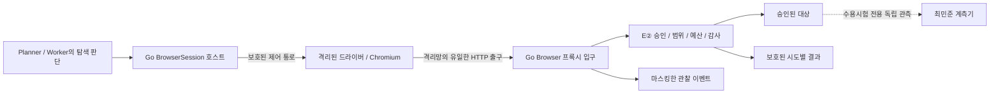

# E② Browser 실행기 설계안

상태: **팀 검토용 제안, 구현·수용시험 미실행.** 2026-11-11, 이동찬 작성.
코드 대조 기준은 `dev` `596b217caac892121d0fb1316ca1651f2fc5dddd`다.
일정·우선순위의 정본은 [개발 계획](development-plan.md)이며, 이 문서는 새 Browser 실행 경계만 정한다.
[이벤트 계약](contracts/browser-execution-events.md)과 함께 검토한다.

## 1. 결정할 구조

**탐색 판단은 기존 Planner/Worker가 하고, 실제 전송 허용은 Go E②가 한다.**
브라우저를 기존 Bash 명령으로 띄우는 대신 별도 격리 실행 프로필로 관리한다.
페이지·드라이버가 프록시를 무시해도 대상에 직접 연결할 수 없어야 한다.
이 문서만으로 Browser 지원이나 전 경로 통제 완료를 선언하지 않는다.

프록시 설정과 Playwright 요청 가로채기는 보조 설정이다. 실제 출구 제한은 OS 격리,
현재 승인 검사는 E②, 대상 도달 증명은 독립 수신·계측 결과가 맡는다.

## 2. 합의한 승인 의미

크롤링 시작 전에 `crawl_permission` **설정 하나**를 승인한다. AI 브라우저 탐색도 크롤링에 포함한다.

| 설정 | 크롤링 중 전송 | 발견 기록 |
| --- | --- | --- |
| `read_only` | 승인 범위의 GET·HEAD | 쓰기 요청은 보내지 않고 발견·차단으로 남김 |
| `approved_writes` | 승인 범위의 GET·HEAD와 승인된 쓰기 메서드, 건별 재확인 없음 | 허용·거부·미지원과 실제 전송 결과를 각각 남김 |

두 설정 모두 대상 origin·경로·메서드·예산·감사를 E②가 집행한다.
DELETE·위험 경로·위험 query 차단은 유지한다. `approved_writes`가 모든 메서드의 허용을 뜻하지 않는다.
GET·HEAD도 애플리케이션 상태를 바꾸지 않는다는 보증은 아니다.

승인 화면 문구 제안:

> 탐색 중 어떤 쓰기 요청이 발견될지 미리 알 수 없으며, 허용한 쓰기로 대상 상태가 바뀔 수 있습니다.
> 선택한 탐색 권한 안에서도 대상·경로·메서드·예산 제한과 위험 요청 차단을 적용합니다.

심화 진단의 기존 모드별 승인 규칙은 유지한다. 크롤링 쓰기 승인을 심화 진단으로 넘기지 않는다.
로그인은 별도 `auth_prepare` 단계로 준비하고 크롤링 쓰기와 따로 센다. 인증 준비 역시 E②를 거치며,
전체 송신 예산에서 임의로 제외하지 않는다. 실제 인증 연결은 2단계 범위다.

## 3. 현재 코드에서 재사용할 것과 새로 만들 것

| 현재 근거 | 재사용 범위 / 필요한 변경 |
| --- | --- |
| [e2runner](../e2runner/runner_linux.go), [결과 타입](../e2runner/runner.go) | 의도 결속·호출 수명·철회·drain 패턴. 현재 실행과 `ProcessBashExited`는 Bash용이므로 Browser 결과로 위장하지 않음 |
| [e2sandbox](../e2sandbox/helper_linux.go) | namespace·UDS relay·capability 제거의 구조. 현재 Bash 실행 명령·runtime mount·seccomp를 Browser에 그대로 적용할 수 있다고 가정하지 않음 |
| [e2proxy](../e2proxy/http.go), [전송 코어](../e2proxy/execution.go) | peer 결속 프록시, HTTPS 검사, 요청별 정책 검사, 공유 예산, 감사·Receipt. Browser 전용 입구 관찰과 결과 수집 경계를 추가 제안 |
| [요청 승인](../e2proxy/request_approval.go), [추가 제한](../e2proxy/request_boundary.go) | 기존 기본 모드는 유지. 크롤링 권한을 호스트가 별도 제한된 사전 승인으로 발급해야 함 |
| [HTTP 관찰](../e2proxy/diagnostic.go) | 마스킹한 제품 표시의 참고. 최대 32개 관찰과 잘림 표시는 전체 발견 목록·보존율 분모가 아님 |
| [기존 Browser MCP 연결](../server/manager.go) | 트래픽 캡처용 프록시 설정은 E② 강제·격리의 증거가 아님. 이 실행기의 대체 경로로 사용하지 않음 |

기존 `e2-http-v1` Receipt·감사 저널·공식 정책·등록 GET/IDOR 계약은 바꾸지 않는다.
새 이벤트는 보호된 결과의 투영이며 독립적인 새 실행 권한이 아니다.

## 4. 실행 권한과 예산 결속

Go 호스트가 검증한 task/run/intent·대상 승인·정책 revision·예산 참조·만료·실행 프로필을 묶어
Browser 세션을 연다. `browser_session_ref`는 이 실행 수명의 식별자이며 인증 세션 참조와 다르다.
모델은 권한, 단계, 예산, 프록시, CA, 실행 바이너리·인수·환경을 고르거나 바꾸지 못한다.

크롤링 권한 발급 제안은 다음과 같다.

1. 서버의 원래 대상·경로·메서드 승인과 `crawl_permission`을 교집합한다. 읽기 승인은 GET·HEAD만,
   쓰기 승인은 원래 승인된 메서드 중 DELETE를 뺀 범위만 남긴다. 위험 경로·query 제한도 그대로 결속한다.
2. `recon`에만 유효한 호스트 발급 사전 승인 실행을 만든다. 기존 `ApprovalPreauthorizedScope`의 의미를
   재사용할 수 있지만, 문자열을 모델 입력에서 받아 설정하지 않는다. 쓰기에 `PreapprovedRead=true`를
   반환하거나 기존 Workbench 확인 게이트를 전역 해제하는 방식은 사용하지 않는다.
3. Browser 세션 하나를 E② Call 하나에 결속한다. page·iframe·popup·백그라운드 요청도 같은 Call을 쓴다.
   액션이나 페이지마다 새 승인·예산을 만들지 않는다. 같은 승인 예산의 다른 Worker·Bash와 같은 ledger를 쓴다.
4. 승인 축소·철회·만료·중지는 다음 실제 전송 경계에서도 다시 검사한다. 권한 확대는 새 승인이 필요하다.
5. 요청 수는 기존 ledger의 예약 의미를 그대로 따른다. 발견 수·페이지 수·도구 턴 수는 각각 별도 상한이다.
   차단 요청도 attempt/denial 상한을 소비할 수 있으며, 송신 예산과 같은 숫자로 합치지 않는다.

`auth_prepare`와 `diagnosis`는 별도 호스트 권한 문맥이다. URL에 `login`이 있다는 이유로 단계를 바꾸거나,
페이지가 주장한 로그인 성공으로 인증 주체를 확정하지 않는다. 1단계에서는 익명 `recon`만 연다.

## 5. Browser 전용 격리 프로필

선택안은 **Go 수명 관리자 + 고정된 Playwright/Chromium 드라이버**다. 드라이버는 격리 영역 안에서
브라우저를 제어하며, 전송 승인 코드는 Go 밖으로 옮기지 않는다. 새 패키지·runtime 설치와 버전·해시 고정은
아직 수행하지 않았다. 의존성 및 배포 설정 변경은 구현 전 담당자 검토 대상으로 남긴다.

| 경계 | 1단계 요구 |
| --- | --- |
| 프로세스 | 새 user/pid/mount/net namespace, 권한 제거, 자식까지 동일한 출구 제한. Browser는 비 root로 실행하고 Chromium 자체 sandbox도 켬 |
| 네트워크 | 격리망에는 host 소유 UDS relay로 가는 loopback 프록시만 제공. 직접 IPv4/IPv6·DNS/UDP·다른 relay·host 네트워크·기존 외부 연결 FD 없음 |
| 파일·제어 | 고정 runtime을 읽기 전용 mount, profile·임시 파일은 세션 전용. host 작업 폴더·Docker/DBus 소켓·개인 브라우저 프로필·CA 개인키·비밀 환경 없음. 제어는 상속된 전용 pipe, 공개 CDP 포트 없음 |
| Browser 설정 | 새 비영속 context, service worker 차단, 다운로드·확장·trace/HAR/console 원문 저장 비활성. 대상 loopback 주소도 프록시에서 빠지지 않게 고정 설정. 임의 실행 인수·외부 브라우저 연결 금지 |
| HTTPS | Browser가 E② 공개 CA를 신뢰하고 upstream은 Go가 검증. `ignoreHTTPSErrors`, 인증서 무시 인수, TLS 실패 후 터널 fallback 금지 |
| 미지원 | WS·QUIC·WebRTC의 외부 송신, 불투명 CONNECT, file/ftp 등 대상 탐색은 차단·미지원. blob/data worker의 네트워크도 동일 경계 적용 |
| 자원 | 시간·메모리·프로세스·FD·본문·동시 요청·이벤트 크기/수의 양수 상한을 고정 프로필로 공급. 무제한·누락이면 시작 거부 |

**선행 확인이 필요한 지점:** 현재 Bash helper는 초기 UID 0과 후속 namespace 전환을 막는 seccomp를 사용한다.
Chromium 내부 sandbox와의 UID mapping·syscall·runtime mount 호환성을 별도 Browser 프로필로 먼저 시험해야 한다.
기존 Bash 필터를 전역 완화하지 않는다. 조건을 만족하지 못하면 Browser unavailable로 종료하고,
`--no-sandbox`나 격리 밖 브라우저로 자동 전환하지 않는다.
Playwright의 sandbox 기본값에 의존하지 않고 명시적으로 켜야 한다.
이는 [BrowserType 공식 문서](https://playwright.dev/docs/api/class-browsertype#browser-type-launch-option-chromium-sandbox)와
[크롤링 실행의 사용자·seccomp 권고](https://playwright.dev/docs/docker#recommended-docker-configuration)를 참고한 선택안이며,
우리 배포에서의 실제 호환성은 미검증이다.

### 인코딩과 인증의 지원 경계

현재 E②는 `Accept-Encoding` 미지정/`identity`만 받으며 upstream 자동 압축 해제를 하지 않는다.
Browser 전용 입구에서 **이 협상 헤더만 `identity`로 제한하는 명시적 프로필**을 제안한다.
원래 인코딩 협상값은 기록하지 않고 적용 여부만 프로필에 고정한다. 메서드·URL·query·본문·자격 헤더를
바꾸어 허용 요청으로 만드는 기능은 두지 않는다. 기본 Bash 전달 프로필·공식 평가 프로필에는 적용하지 않는다.
이 차이는 보존 시험 조건에 기록한다. 인코딩된 응답이 오면 기존 미지원/불명 의미를 유지한다.

기본 전송 모드의 Cookie·Authorization 및 Set-Cookie 응답 제한도 유지한다.
1단계 성공을 인증된 SPA 탐색 성공으로 해석하지 않는다. 2단계 보호 인증 설계에서 비밀 취급과 응답 경계를
별도로 합의한다. `NODE_EXTRA_CA_CERTS` 설정만으로 Chromium 신뢰 저장소가 준비됐다고 판단하지 않는다.

## 6. 호스트 제어 인터페이스 제안

아래 이름은 새 Go 내부 경계의 제안이며 공개 HTTP API나 기존 MCP 도구 계약의 변경이 아니다.

| 호출 | 입력 / 반환 의미 |
| --- | --- |
| `Open` | 서버가 발급한 보호된 authority·runtime·limits와 event sink → 세션 handle. 권한 검사·격리·CA·Call 결속까지 성공해야 ready |
| `Navigate` | handle + 호스트가 검증한 대상 참조 + 제한된 대기 조건 → 액션 참조/드라이버 결과 |
| `WaitForSelector` | handle + 길이 제한된 비밀 없는 selector + timeout → 드라이버 관찰. 임의 JS 실행·네트워크 함수 호출 입력은 받지 않음 |
| `Fence` | host 중지 사유 → 신규 액션·전송 차단 접수. 접수 ACK는 종료 완료가 아님 |
| `CloseAndWait` | timeout → Browser/자식·프록시·Call drain, 감사·이벤트 완결 상태를 담은 보호된 결과 |

시작 대상의 실제 URL은 호스트 내부에서만 해석한다. 대상 앱의 URL·selector·폼·계정은 코드에 박지 않는다.
1단계는 수용시험을 구동할 최소 Navigate/Wait 제어까지다. 동적 후보 공급·로그인·발견 상한은 2단계,
Worker의 click/fill/도구 관찰·API Recon 연결은 3단계로 둔다. 보존 목표 때문에 이 후속 기능을 삭제하지 않는다.

## 7. 요청 관찰과 실제 전송의 흐름

1. 격리된 브라우저가 보낸 실제 HTTP 요청을 Go 프록시가 파싱한다. 미지원·범위 밖·쓰기 차단을 포함해
   관찰 가능한 요청에 호스트 `request_ref`를 붙인다. 실제 method/URL은 private 메모리 경계에서만 사용한다.
2. **승인 검사 전** 관찰을 마스킹해 이벤트로 기록한다. `RequestBoundary.Before`만으로 구현하면 그 전에 거부된
   메서드·origin 등을 놓치므로 Browser 프록시 입구에 별도 훅이 필요하다. 파싱 불가·TLS 실패는 구분해 기록한다.
3. 기존 E②가 현재 승인·위험 제한·범위·본문·예산을 검사하고 송신 전 감사를 완료한다.
   거부는 대상 서버의 403 같은 응답으로 저장하지 않는다. 브라우저에 보이는 프록시 실패와 대상 응답을 구분한다.
4. E②가 실제로 발급한 AttemptID와 보호된 Receipt를 호스트가 수집해 `attempt.result`로 투영한다.
   현재 프록시가 버리는 `Call.Do`/`Call.Reject`의 Receipt 수집도 구현 항목이다. 원 감사 형식은 유지한다.
5. E②가 덮어쓰는 기존 `X-ABC2LAB-E2-Attempt`가 독립 계측기의 조인 키다. 요청의 경로·시각·메서드나
   드라이버 request ID로 추측하여 연결하지 않는다. 외부 송신이 없는 거부에는 계측기 행이 없는 것이 정상이다.

리다이렉트 후 요청도 별도 검사·시도다. Chromium 자체 재시도가 생기면 각각 경계에서 검사·계수한다.
호스트가 실패한 쓰기·결과 불명을 자동 재실행하지 않는다. 페이지 로드 성공, HTTP 200,
드라이버의 `requestfinished`는 실제 도달·로그인 성공·취약점 확정의 대체 근거가 아니다.

백그라운드 요청이 액션 종료 후에도 나올 수 있으므로 1단계 네트워크 이벤트의 `action_ref`는 null이다.
브라우저 세션과 E② Call까지 정확히 결속하고, 개별 UI 액션의 인과 관계는 주장하지 않는다.
Playwright route만으로 전체 관찰을 만들지 않는 이유에는
[service worker 요청 가로채기의 제한](https://playwright.dev/docs/api/class-browsercontext#browser-context-route)도 있다.
OS에서 막힌 직접 UDP/DNS 시도에는 HTTP 이벤트가 없을 수 있다. 이벤트 부재만으로 우회 0건을 주장하지 않는다.

## 8. 수명과 실패 처리

상태 흐름은 `opening → ready → fenced → draining → closed`다. ready 중 액션을 직렬 실행하되,
네트워크 요청은 승인된 동시성 한도에서만 진행한다. opening 실패도 정리 결과를 반환한다.

- 중지·일시정지·철회·만료·예산/자원 한도·감사/필수 이벤트 저장 실패는 신규 전송부터 fence한다.
  이어 context·프로세스와 프록시를 닫고 Call을 drain한다. 이미 나간 쓰기를 취소·원복했다고 표시하지 않는다.
- 1단계 pause도 해당 Browser 세션을 닫는다. 재개는 새 세션/Call을 열되 같은 승인 예산을 이어 쓰며,
  새 승인이 필요한 권한 확대나 예산 초기화는 하지 않는다. 인증 상태 복원은 2단계 별도 설계다.
- 프로세스 종료·자식 정리·프록시 drain·감사·필수 이벤트 기록을 각각 확인한다. 하나라도 불명이면
  종료 결과는 `incomplete`이며 재시도 허가나 진단 완료로 변환하지 않는다.
- 관찰 이벤트는 크기가 제한된 순차 저장과 ACK를 요구한다. 필수 기록을 조용히 샘플링·덮어쓰기하지 않는다.
  포화 시 제한 사유를 남기고 중지한다. 저장 자체가 실패하면 별도 보호된 종료 반환에서도 누락/불명을 알린다.

`session.closed=completed`는 이 실행기의 정상 종료만 뜻한다. 탐색 완전성·보존율·취약점 부재·운영 수용을 뜻하지 않는다.
세부 필드·조인·정합 조건은 [이벤트 계약](contracts/browser-execution-events.md)에 둔다.

## 9. 검증과 3단계 연결

[Browser 수용시험](evaluation/browser-acceptance.md)은 검증 항목의 근거이며,
쓰기 승인·S13·보존 세 줄의 개정은 [#371](https://github.com/ABC2LAB/ABCDEF2LAB/pull/371) 검토안과 이번 합의를 따른다.
위 기준 SHA에는 #371이 포함되지 않으므로 개정 채택과 실제 시험을 구분한다.
시험 대상은 설정으로 지정한 소유·승인 origin으로 제한한다. 상태 변경 재현은 별도 승인된 시험환경에서
대상 인스턴스를 초기화한 뒤 수행하고, 보존 회차도 같은 초기 상태로 맞춘다.
평가 정답은 평가기에만 두며 탐색·판정 입력으로 넣지 않는다.

| 단계 | 산출물과 수용 범위 |
| --- | --- |
| 선행 호환성 확인 | 실제 배포에서 비 root Chromium sandbox·namespace·UDS·CA·고정 runtime 기동 및 종료 확인. 실패 시 지원 보류 |
| 1. E② Browser 실행기 | P01–P07 정상 전달·인코딩·TLS·예산·수명, B01–B14 우회/읽기 승인 차단. 허용 양성 대조와 독립 계측의 시도별 대조 필요 |
| 2. 동적 발견·인증·상한 | 정적 파서는 후보, 브라우저 관찰은 실제 method/URL 근거. 발견/전달 구분, 보호 인증, 발견 상한, #371의 S13 쓰기 승인 무건별 확인·상태 변경 고지·단일 설정 분기 검증 |
| 3. Worker 도구·API Recon | 기존 탐색 판단을 이 실행기에 연결. 기존 host Browser MCP 우회 차단, mock 로그인과 실제 인증 구분, 비밀·원문 산출물 재검토 후 보존 시험 |

기존 API Recon 스크립트를 그대로 실행하거나 mock 로그인으로 실제 인증을 대체하지 않는다.
#370 fixture의 통제 없는 Chromium 양성 대조(B08 QUIC 제외) 결과는 팀이 전달한 준비 근거다.
E②에 연결한 실제 Browser 수용, B08 양성 대조 또는 이 설계의 실행 결과로 세지 않는다.
양성 대조가 성립하지 않은 우회 항목은 차단 성공 대신 UNDECIDABLE로 남긴다.

보존 측정은 다음 세 줄로 보고한다. 충분한 예산·모델/도구/턴 조건·R-F 전체 보존율 통과선은 **결과를 보기 전에** 고정한다.

| 줄 | 승인 / 예산 | 용도 |
| --- | --- | --- |
| R-P | 쓰기까지 / 100회 | 제한된 예산의 영향 |
| R-F | 쓰기까지 / 충분한 예산 | **전체 보존율 완료 기준** |
| R-R | 읽기만 / 충분한 예산 | 쓰기 차단에 따른 차이 |

통제 결과와 보존 결과는 별도 지표다. SPA·인증·도구/턴·예산·미지원 경로의 차이를 그대로 보고한다.
공식 E② 정책과 평가 러너 경로는 유지하며 Browser 결과를 공식 baseline/개선 비교 수치에 합산하지 않는다.

## 10. 담당자에게 넘길 경계와 열린 결정

| 담당 | 이 초안에서 검토할 것 |
| --- | --- |
| 이동찬 | 별도 Browser 격리 프로필, 보호 권한 발급, 프록시 관찰/Receipt 수집, fence·drain·이벤트 구현 |
| 최민준 | [이벤트 계약의 계측기 연결](contracts/browser-execution-events.md#7-최민준-계측기와의-연결-제안), 보존용 경로 기록 옵션·마스킹 벡터·시도별 대조·충분한 예산/통과선. 공식 회차와 분리 |
| 이경준 | 승인 설정 하나, 상태 변경 고지, 발견/거부/송신/미실행과 부분 탐색 표시. UI/API 변경은 별도 담당자 리뷰 |

구현 전 확인할 열린 항목은 ① 배포별 Chromium sandbox 호환성, ② runtime/의존성 버전·해시와 설치 방식,
③ Browser 협상 헤더 프로필 채택, ④ 이벤트 영속 저장소·크기/수 상한과 보존 기간,
⑤ 계측기 경로 마스킹 프로필 및 R-F 예산/통과선이다. 인증 경계는 2단계에서 합의한다.
이 문서는 담당자 영역의 코드 수정·공식 정책 개정·새 의존성 설치를 수행한 결과가 아니다.
