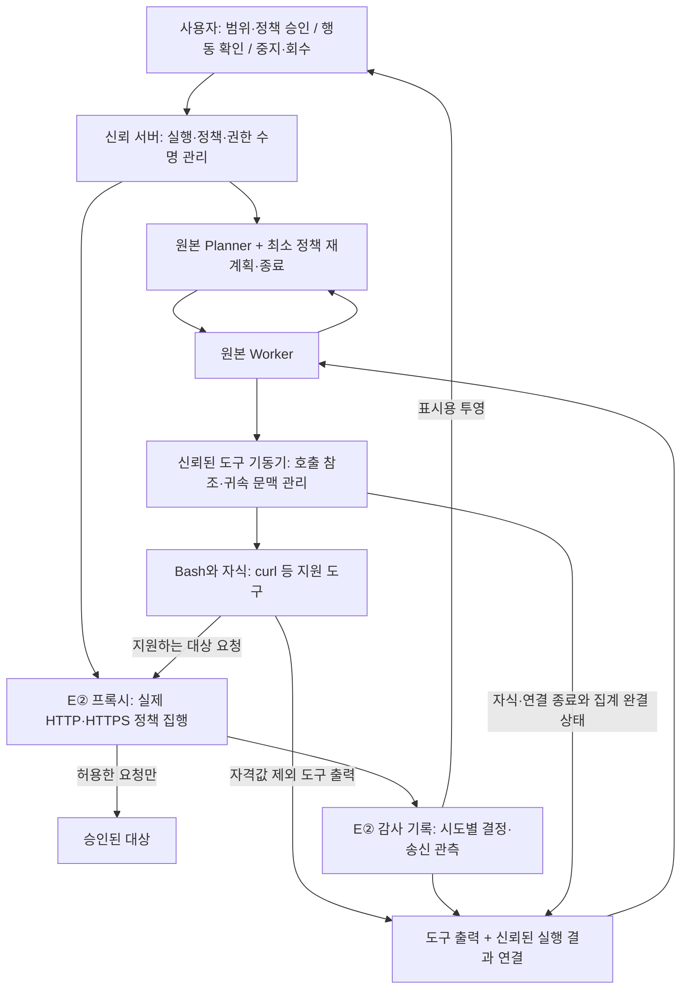

# 원본 엔진·Bash 유지형 E② 프록시 통제 — 최종 검토 초안

2026-11-05 · 이동찬 정리 · **합의 방향 반영 / 팀 최종 검토용 Draft / 운영 비활성**

이 문서는 원본 엔진 루프를 유지하면서 사용자가 AI의 행동을 확인·통제하는 방향과,
전달받은 평가 담당 회신·Bash 조사 집계를 정리한다. 대화에서 합의한 문구·검증 원칙과
호출별 귀속 토큰의 기술 제안을 구분한다. 구현 완료·배포 승인·전체 팀 채택 또는 실제 진단 성공의 근거가 아니다.

팀 계획의 기준은 [개발 계획](development-plan.md)이다. 이 문서는 기존 계약·API·감사 형식·채점 규칙을 자동 변경하지 않는다.
문서만 작성하며 실행 권한·키·토큰·계정·배포 설정을 발급하거나 활성화하지 않는다.

## 1. 결정의 목적과 적용 범위

목표는 **원본 Planner·Worker 루프와 Bash 도구를 최대한 유지하면서, 사용자가 무엇을 실행하는지 보고
어디까지 실행해도 되는지 통제할 수 있는 펜테스팅 도구**다.

승인 범위 안에서는 자동 진단을 진행한다. 범위를 넘는 요청은 송신 전에 거부하고,
사용자가 정책을 변경하면 다음 실행 시도에서 현재 정책을 다시 확인한다.
새 승인을 받았다는 이유로 이전의 원시 요청이나 명령을 자동 재생하지 않는다.

**합의한 통제·측정 문구:**

> 승인한 대상·범위·허용 메서드·예산에 따라 요청을 통제하고, 관측 가능한 대상 상태의 변화를 별도로 측정한다

메서드 허용 목록은 정책 집행 기준이다. GET의 부작용까지 자동 판별하거나 운영 DB 오염을 전부 막는다는 뜻은 아니다.
상태 전후 비교도 관측 범위의 변화만 설명하며, 일시적 변경·외부 통지·다른 사용자의 동시 변경을 모두 포착한다고 주장하지 않는다.
운영 웹의 상태 변경 시험은 별도 승인·시험 데이터·중지 및 정리 조건이 마련된 범위에서 다룬다.

첫 통합 진단의 완료 기준은 원본 루프 → 지원 도구 → E② → 대상 → 실행 결과 피드백 → 감사·결과 저장·사용자 표시가
같은 실제 회차에서 연결되고, 허용·차단·중지·결과 불명이 독립 관측과 대조되는 것이다.
등록 GET 두 건의 연결 시험은 유효한 중간 단계이며, 일반 Bash 송신 통제 완료로 확대하지 않는다.

## 2. LLM 배치와 대상 송신 경계

| 항목 | 합의한 방향 |
|---|---|
| 기본 LLM | 내부 PC·서버의 로컬 LLM. 폐쇄망·민감한 운영 웹 진단의 기본 경로 |
| 개발·평가 대안 | OpenRouter 등 외부 LLM API를 **공개 연습 대상의 개발·평가 회차에서 명시적으로 선택** |
| 실패 처리 | 로컬 설정·모델 연결 실패를 외부 API 자동 전환으로 복구하지 않음 |
| 외부 전달 | 외부 API 선택 시 프롬프트·대상 응답 일부가 제공자로 전달됨. 비밀번호·쿠키·인증 헤더·토큰 원문은 제외 |
| 비교 해석 | API 절대 성능을 로컬 배포 성능으로 옮기지 않음. 제공자·모델·샘플링 고정·기록은 평가 계약을 따름 |

LLM 접속 경로와 대상 웹앱 송신 경로는 별도로 관리한다. 로컬 provider 선택만으로 제품 전체의 외부 송신 차단을 증명하지 않는다.
OpenRouter의 용도 제한은 운영 원칙이며, 코드가 대상 데이터의 비민감성을 자동 판별한다는 뜻은 아니다.

## 3. 원본 루프와 프록시의 역할

이 그림은 목표 흐름이다. 도구 영역의 직접 대상 송신은 OS·컨테이너 등 실제 배치 경계에서 차단하고,
지원하지 않는 도구·프로토콜·원격 MCP 경로는 명시적으로 차단하거나 제외한다.
프록시 환경변수만으로 강제 경유를 주장하지 않는다. Planner·chat·enrichment 등 다른 실행 주체도 경로 목록에 포함한다.
원격 MCP가 자신의 서버에서 대상을 호출하는 경로는 로컬 프로세스 격리만으로 통제됐다고 보지 않는다.

프록시는 TLS 안의 메서드·경로 등 검사에 필요한 내용을 볼 수 있는 지원 경로를 사용하고,
대상 인증서 체인·호스트 검증을 유지한다. 검사 불가·TLS 실패·감사 장애 때 직접 연결이나 투명 터널로 넘기지 않는다.
현재 승인·만료·철회·실행 범위·예산을 실제 송신 직전에 검사한다.
기존 keep-alive·CONNECT·HTTP/2 연결도 새 요청의 검사를 생략하는 권한이 되지 않는다.
리다이렉트·재시도·재연결은 지원 계약을 따르며, 추가 송신마다 새 시도와 현재 정책·예산을 적용한다.

정책 차단은 대상 HTTP 응답과 분리한 신뢰된 실행 결과로 엔진에 전달한다.
전용 헤더·본문·상태 코드는 호환·표시 보조 수단이며, 출처 증명이나 E③ 판정 근거를 대신하지 않는다.
차단 반복 제한·총 예산·재계획/종료는 프로그램이 관리한다. 첫 회차에 필요한 최소 E①과 후속 성능 개선은 구분한다.

## 4. Bash 조사: 전달받은 1회차 집계

**출처:** 평가 담당자가 공유한 원본 `e53a79f` 1회차, API 공식 고정값을 사용했다는 보고, 소요 254초.
이 문서 작성에서는 원본 transcript·스캔 로그를 열거나 회차를 재실행하지 않았다.
짧은 커밋 참조·설정 적용·제공자·계측 기록의 완결성을 대조한 공식 평가 결과로 승격하지 않는다.

| 구분 | 공유된 집계 | 해석 범위 |
|---|---|---|
| 전체 도구 호출 | Bash 43회, WebFetch 18회, MCP 0회 | Bash 43회 모두 curl 실행 |
| seal 이전 Bash 호출 | 37회 | transcript의 호출 시각 기준 |
| 계측기를 통과한 대상향 요청 | 361건: curl 346건(95.8%), WebFetch 15건(4.2%) | 당시 계측의 전달 집계이며 앱 처리 완료 증명과 구분 |
| 추가 curl 접수 | seal 뒤 계측기 거부 36건 | E② 정책 거부 또는 대상 전달로 계산하지 않음 |
| 회차 전체 curl발 HTTP 계측 접수 | 382건 = 통과 346 + seal 뒤 거부 36 | 전달·거부를 합친 HTTP 요청 수이며 curl 프로세스 기동 횟수가 아님 |
| seal 이전 총량 평균 | 346 ÷ 37 = 약 9.35건(소수 첫째 자리 약 9.4건) | 같은 seal 경계를 사용하되 호출별 귀속은 없음 |
| 전체 회차 총량 평균 | 382 ÷ 43 = 약 8.88건 | 계측기 거부 포함 접수 평균. 전달 평균과 구분 |
| 반복·도구 분포 | 루프 호출 13회, python·sqlmap 0회 | 루프 수는 공유한 분류이며 추가 검증하지 않음 |
| 메서드 분포 보고 | curl의 POST·PUT·DELETE·PATCH 합계 59건 | seal 전후 어느 요청 집합인지 추가 확인. 실제 상태 변경 59건이라는 뜻은 아님 |
| 기타 송신 분류 | MCP·엔진 자체 대상 요청 0건이라는 보고 | 이번 회차의 관측·UA 분류 범위에 한정 |

**346 ÷ 43은 seal 기준이 다른 분자·분모를 섞으므로 사용하지 않는다.**
두 평균 모두 총량의 비율이며, 요청을 각 Bash 호출에 귀속한 호출별 분포·분산이 아니다.
호출 수는 transcript 시각, 요청 수는 계측 관측 시각에서 온다. 시각 경계가 같아도 개별 호출과 요청의 대응이 증명되지는 않는다.
WebFetch 18회는 전체 도구 호출 수이고 15건은 계측기를 통과한 HTTP 요청 수다. 단위·구간과 개별 대응이 같다는 근거가 없으므로
단순히 3건 누락으로 계산하지 않는다. 호출별 대상/비대상 요청·거부·실패의 분류는 미확인으로 남긴다.
UA는 위조 가능하므로 출처 인증 근거가 아니다. 1회차 결과를 일반적인 Bash 비율이나 다른 도구의 호환성으로 일반화하지 않는다.

이 조사에서 얻는 설계 근거는 **관측된 주 송신 경로인 Bash/curl을 유지할 가치가 크며,
도구 호출 수와 HTTP 요청 수를 분리해서 관측해야 한다**는 것이다. python·sqlmap·MCP 지원은 별도 시험이 필요하다.

## 5. 호출별 프록시 귀속 토큰과 신뢰된 결과

### 5.1 제안과 식별자 구분

신뢰된 기동기가 Bash 호출마다 프록시 귀속 문맥을 만들고, 프록시가 요청을 해당 호출에 결속한다.
호출 단위 토큰 사용은 이 문서에 포함하는 기술 제안이다. 안전한 전달 경로·연결 수명·배포 방식은 최종 검토 대상이다.
아래 명칭은 **논리적 식별자**이며 새 JSON/API/DB 필드나 기존 enum으로 확정한 것이 아니다.

| 구분 | 의미·신뢰 범위 | 노출 원칙 |
|---|---|---|
| 실행 참조 | 신뢰 서버가 결속한 task/run/reset·정책 버전 | 표시용 참조만 사용. 모델이 제출한 값을 권한으로 신뢰하지 않음 |
| 도구 호출 참조 | Bash 호출 한 번과 그 자식·연결 수명의 식별자 | 공개 가능한 불투명 참조. 사용자 화면·결과 연결에 사용 |
| 프록시 귀속 토큰 | 해당 호출의 프록시 귀속 문맥을 조회하는 단명 내부 자격 | **비밀 취급**. 승인 증명·대상 API 키·공개 상관 ID가 아님 |
| E② 시도 ID | E②가 요청 판정 전에 발급하는 HTTP 시도 하나의 참조 | 계측·대조용. 형식이 맞아도 승인 증명은 아님 |

귀속 토큰이 유효하더라도 요청은 현재 E② 정책 검사를 별도로 통과해야 한다.
토큰·호출·워커를 새로 만들거나 재발급해도 실행의 총 예산·중지·만료·회수를 초기화하지 않는다.
존재하지 않거나 만료·회수·다른 호출에 속한 귀속 문맥은 정상 허용으로 처리하지 않는다.

### 5.2 비밀 전달과 요청 결속

- 토큰 원문을 LLM 입력·명령 문자열·인자·전달 JSON·공유 로그·근거 파일·UI에 넣지 않는다.
  일반 Bash 환경변수에 넣으면 명령이 이를 읽어 출력할 수 있으므로 안전한 전달 완료로 인정하지 않는다.
  신뢰 실행기·호출별 접점 등으로 원문을 숨기면서 기존 도구를 연결하는 방식을 검토·시험해야 한다.
- 프록시가 귀속 토큰을 소비하고, 대상에 보내는 요청에서는 토큰과 프록시 자격 헤더를 제거한다.
  HTTP·CONNECT 이후 HTTPS·재시도·상위 프록시 경로 모두에서 대상 유출 0을 시험한다.
  `Proxy-Authorization` 등 특정 헤더의 이름만으로 제거를 보장하지 않는다.
- 모델·도구가 넣은 시도 ID는 신뢰하지 않는다. 프록시가 발급한 ID로 교체하며,
  도구 호출·실행·현재 정책과 결속된 내부 기록을 만든다.
- 호출 토큰은 여러 HTTP 시도를 귀속할 수 있다. HTTP 시도 ID는 각 새 전송 시도마다 별도로 발급한다.
  재시도·리다이렉트·재연결을 이전 ID 재사용으로 숨기지 않는다. 새 ID도 예산을 새로 만들지 않는다.
- CONNECT·keep-alive·HTTP/2·연결 풀에서 호출 문맥이 다른 호출로 넘어가지 않게 한다.
  이 결속을 검증하지 못한 연결 재사용은 지원하지 않는다.
- 일반 Bash 요청의 실제 계정·세션 참조 및 자격 주입도 신뢰된 실행 문맥에 결속해야 한다.
  귀속 토큰·UA·LLM의 계정 주장만으로 요청의 인증 계정을 확정하지 않는다.

### 5.3 Bash 종료와 집계 완결

Bash의 직접 프로세스 반환과 호출의 네트워크 작업 종료는 다르다.
백그라운드 자식·열린 터널·진행 요청을 추적하고, 호출 마감 시 신규 송신 차단 → 자식/연결 drain 또는 종료 →
감사 마감·내구 저장 확인 → 최종 집계 순서로 관리한다.
결과 조회는 인증된 서버 내부 경로로 수행하고, Bash가 stdout으로 제출한 수치를 신뢰 결과로 채택하지 않는다.

종료 대기·감사 저장이 불명확하면 미완료 상태와 뒤늦은 관측 가능성을 보존한다.
중간 집계를 보여줄 수는 있지만 최종 집계로 표시하지 않는다. 프로세스 종료가 대상 서버의 이미 시작된 처리를 취소한다는 뜻은 아니다.
회수 뒤 열린 연결로 새로운 요청을 보내는 경로도 차단 시험에 포함한다.

워커에 붙이는 신뢰 결과는 적어도 다음 축을 분리한다.

- 정책 결정: 허용 시도 수, 정책 거부 시도 수.
- 실행 관측: 송신 전 미전달 확정, 송신 시도, 응답 수신, 송신 후 결과 불명.
- 마감 상태: 진행 중/마감 미완/최종 집계와 기록 완결 여부.

예를 들어 허용한 요청이 응답 유실로 결과 불명이면 허용 수와 결과 불명 수에 각각 속한다.
따라서 **허용 N + 정책 거부 M + 불명 K를 서로 배타적인 총 시도 수로 합산하지 않는다.**
명령의 정상 종료·HTTP 403·대상 페이지 문구도 이 신뢰 결과를 대신하지 않는다.
인증 값이 제거된 도구 출력과 프로그램의 실행 결과를 분리해 워커에 전달하고, E③는 실제 지원 증거가 부족하면 판단불가로 남긴다.

## 6. 독립 계측과 개선판의 5칸 대조

### 6.1 관측 단계와 상관 ID

| 기록할 단계 | 의미 | 이 단계만으로 주장할 수 없는 것 |
|---|---|---|
| 접수 | 계측기가 요청을 받음 | 대상 전달·앱 처리 완료 |
| 전달 시도 | 대상 방향으로 연결·요청 쓰기를 시도함 | 대상 수신·상태 변경 없음 |
| 응답 수신 | 대상 방향의 응답 헤더/본문을 관측함. 본문 완료·중단도 구분 | 취약점 여부·모든 부작용의 부재 |
| 결과 불명 | 송신 가능성이 있으나 응답·처리 결과를 확정할 수 없음 | 전송 전 차단·미실행·정상 완료 |

이 단계들은 같은 시도의 진행 이력이므로 서로 배타적인 요청 수로 합산하지 않는다.
접수 후 seal 거부처럼 **전달 시도 전 거부**가 확인된 경우와 송신 후 결과 불명을 구분한다.
계측기 seal 거부와 E② 정책 거부도 다른 원인·단계로 기록한다.

평가 담당은 E② 시도 ID의 길이·문자 집합·버전 등 정한 형식만 검사해 기록하고,
누락·형식 오류·중복·재사용을 채점기에서 대조한다. 형식 오류 원문·다른 헤더·경로·본문은 추가 수집하지 않는다.
헤더 없는 요청·잘못된 ID의 요청도 계측 총량에서 빼지 않고 상태와 건수로 남긴다.
형식 오류 값을 별도 표시할 때도 비밀·임의 문자열을 저장하지 않는다.

ID의 존재·형식 적합성은 E② 경유 인증이 아니다. 동일 실행·호출·시도, E②의 결정·송신 기록,
계측 관측·시각·개수와 실제 배치의 송신자 결속을 대조한다. 재사용 ID를 정상 허용 건에 붙인 우회도 탐지해야 한다.
기록이 늦게 도착하는 동안의 미결속을 즉시 우회로 확정하지 않고, 마감·기록 완결 상태를 함께 본다.
차단을 우회한 무표식 요청은 어느 차단 시도였는지 특정하지 못할 수 있으며 미결속으로 보존한다.

### 6.2 대조표

다음 표는 **개선판의 E② 수용 검증에만 적용**한다.
‘관측됨’은 먼저 지정한 독립 관측 지점의 접수를 뜻하며, 전달·응답 단계는 별도 열/기록으로 대조한다.
동일 회차·시도 결속, 격리된 트래픽 범위와 마감·기록 완결이 전제다.

| E② 정책 결정 | 독립 계측 접수 | 수용 판정 | 원인 판정·추가 확인 |
|---|---|---|---|
| 허용 | 관측됨 | 경유 정합 후보. 접수만으로 정상 전달 PASS는 아님 | 전달 시도·대상 응답 또는 통제된 대상 수신 근거 확인 |
| 허용 | 관측되지 않음 | 원인 확인. 정상 전달을 요구한 양성 시험이면 목표 미달 | 취소·송신 전 실패·장애·과차단·관측 누락 등을 구분. 즉시 집행 실패로 단정하지 않음 |
| 차단 | 관측되지 않음 | 기대한 차단 결과. 관측·기록 완결 조건에서 PASS | 전송 전 거부인지, 관측 경계가 우회를 포함하는지 확인 |
| 차단 | 관측됨 | 수용 실패 | 우회·전송 후 잘못된 차단 기록·시도 결속 오류 등 원인을 별도로 판정 |
| 기록 없음 | 관측됨 | 회차/시도 대조가 마감된 뒤 수용 실패 | 우회·감사 누락·미결속·다른 트래픽 여부 확인. 원인을 우회로 즉시 확정하지 않음 |

원인 미확정을 안전 통과로 바꾸지 않는다. 미완전한 기록·미해결 미결속은 수용 보류 또는 해당 회차의 미완/무효 사유로 남긴다.
허용 양성 시험은 HTTP·HTTPS의 실제 전달/응답 근거를 요구한다. 모든 요청을 막고 수신 0만 만든 경우는 통과하지 못한다.
‘E② 기록 없음 + 계측 없음’은 시도 발생 자체를 증명하지 못하므로 별도 통제 성공 건으로 세지 않는다.

baseline은 E②·호출 토큰·E② 시도 ID가 없는 것이 정상이다. baseline에 위 표의 ‘기록 없음’을 적용해 실패 처리하지 않는다.
양쪽에 같은 독립 계측·대상 초기화·관측 조건을 적용하고, 제품 E②는 개선판에만 둔다.
계측용 ID 추가가 대상 동작에 영향을 주지 않는지 별도로 확인한다.

전체 비교는 원본 대비 개선판 전체의 효과다. E①·E② 개별 효과를 주장하려면 추가 대조가 필요하다.
시간만 줄었다고 효율 개선으로 결론내리지 않고 허용 범위의 검사량·발견/증거 품질·차단·조기 종료·비용을 함께 보고한다.

## 7. 현재 코드·열린 PR과의 관계

2026-11-05 확인한 원격 `dev`: `87a00392f32e07547941bd78fad895722480bbbc`.
아래 상태는 이 시점의 근거이며 후속 구현·리뷰 때 다시 확인한다.

| 기반·제안 | 현재 경계 | 이 초안과의 관계 |
|---|---|---|
| 원본 Planner/Worker·Bash·WebFetch | 실행·기록 프록시 설정 기반 있음 | 일반 루프를 유지하고 지원 송신에 집행을 연결 |
| 등록 조회 E②·감사·E③ 저장 | 제한 조회 코어 있음 | 재사용 기반이며 범용 프록시의 완성으로 세지 않음 |
| 로컬 provider 모드 | 로컬 기본·검증 실패 시 외부 자동 fallback 금지 코드 있음 | 실모델·운영 manifest 가동과 전체 외부 송신 차단 검증은 별도 |
| 사용자 화면·KG 지도 | 진행/기본 결과/일시정지 일부 연결, 새 실행/승인 등 미연결. #186 지도는 목업 공급 | 명령→요청→허용/차단과 실제 판정 read 연결 추가 |
| #180 최소 구성 초안 | 등록 GET·비평가 IDOR 연결의 별도 Draft | 중간 단계로 유지. 그 완료 기준을 일반 Bash 통제 완료로 확대하지 않음 |
| #183 공통 계약 | `a5d828a9c1860bee566d38aa932d7149642712fb`, 미병합. §1·§3은 정확한 등록 GET/참조만 허용 | 일반 Bash HTTP·HTTPS 정책 모드·TLS 검사·호출 귀속·감사/결과 형식·수용시험은 계약 개정 후 연결 |
| #184 네트워크 코어 | `66dfebc6c4a337fac52b239f493e26302625dc7a`, 미병합. 등록 GET·제한 ACK | 임의 HTTP 프록시나 일반 도구 응답 전달이 이미 구현됐다고 연결하지 않음 |
| #185 배포 검증 | `df1b4d2dfa264890512eea3ff79871a5c33c25f9`, 미병합. 실제 A+B 양성 연결 미수용 | PID0/proc 노출/OS 권한 제약을 우회하지 않고, 새 배치의 실제 수용 근거 필요 |
| #174·#176 | 샘플링/실행 조건·공식 절차의 열린 평가 PR | 계측·토큰·대조 형식은 담당과 정렬. 기존 형식을 조용히 덮어쓰지 않음 |

기존 [엔진 개선 초안](engine-improvement-draft.md)의 전용 HTTP 도구 우선 제안과 이 문서의 일반 Bash 유지 방향은 적용 범위가 다르다.
팀 검토 뒤 살아 있는 개발 계획과 관련 계약에 채택 범위를 명시한다. 이번 문서는 다른 담당자의 열린 PR 파일을 직접 수정하지 않는다.

## 8. 담당 경계와 첫 통합의 수용 항목

| 작업 경계 | 기존 담당·협의 | 이번 초안에서 확인할 산출물 |
|---|---|---|
| 프록시 집행·실행 결속·우회 차단·호출 귀속·결과 연결 | 이동찬, A/B/C 소유자와 협의 | 실제 정책 검사·기동/종료·신뢰 결과. 토큰 비노출·호출 수명 증거 |
| 계측 단계·5칸 대조·시도 ID 검사·채점 | 최민준 등 기존 러너·평가 담당 | 전달받은 회신의 인수 범위. 기존 평가 PR과 형식·무효 사유 정렬 |
| 행동·승인·판정 화면 / KG | 이경준, 윤재상 보조; 서버 projection은 이동찬과 협의 | 명령·호출·시도별 상태와 실제 저장 결과를 표시. 원문 자격값 제외 |
| 검증 입력·fixture/reset·모델/대상 준비 | 기존 입력 대장의 담당자 | 실제 출처·승인·세대·초기화 근거. 미실행 입력을 확인됨으로 채우지 않음 |

다음은 **계획된 수용 항목**이며 이 문서 작성으로 실행·통과한 시험이 아니다.

1. 원본 Planner/Worker/Bash가 실제로 돌고, 지원 HTTP·HTTPS의 허용 양성 요청이 대상 응답/수신 근거까지 연결된다.
2. 허용하지 않은 대상·메서드·범위·만료·철회·예산 초과·검사 실패·감사 실패를 송신 전에 차단한다.
3. 프록시 환경변수 제거·직접 IPv4/IPv6·자식·미지원 프로토콜·불투명 CONNECT의 우회가 검증 범위에서 차단된다.
4. 위조·누락·만료·회수·다른 호출 토큰, 다른 회차 ID·중복/재사용 ID와 호출 간 연결 재사용이 정상 성공으로 합쳐지지 않는다.
5. 토큰·인증 원문이 LLM·도구 출력·argv/일반 env·UI·로그·근거·대상 요청에 노출되지 않는다. 안전 전달안이 없으면 호출 토큰 경로를 활성화하지 않는다.
6. 동시 Bash 호출·백그라운드 자식·Bash 종료 뒤 요청·타임아웃·중지·seal에서 귀속, 신규 차단, drain, 미완 집계가 구분된다.
7. 허용/거부와 응답/불명이 별도 축으로 워커·Planner에 전달되고, 정책 미실행은 취약점 없음으로 저장되지 않는다. 반복·재계획은 유한하다.
8. 5칸 대조와 접수/전달/응답/불명 기록이 개선판에서 맞고, baseline은 E② 기록 없음 때문에 실패하지 않는다.
9. 사용자가 실제 명령·요청·결정·결과를 확인하고 승인 회수/중지가 실제 송신에 반영됨을 본다. 표시용 명령도 비밀값을 제거한다.
10. 실제 계정·승인·KG/fixture·감사·모델·DB·배치 입력을 연결한 첫 한 회차에서 감사·지원 판정·저장·조회까지 확인한다.

## 9. 최종 검토에서 남길 결정

- 토큰의 안전한 전달 방식과 실제 프로세스/연결 결속, 토큰 발급·회수·보호 저장 주체.
- HTTPS TLS 종단·신뢰 루트·대상 인증서 검증, CONNECT/HTTP2/연결 재사용의 최초 지원 범위.
- 일반 Bash 요청의 계정 참조·실제 인증 자료를 비밀 노출 없이 결속하는 방식.
- 새 프록시 실행 결과·감사·시도 ID·계측 단계의 버전과 기존 타입/채점 기록의 호환 처리.
- Bash 호출 종료와 자식·터널 drain·감사 마감의 실제 감독자 및 timeout/뒤늦은 기록 처리.
- 조사 메서드 분포 59건의 seal 전후 요청 집합, 원본 full SHA·집계 시각·설정 근거의 확인.

토큰 제안은 채택 방향과 상세 구현의 안전성을 구분해서 검토한다. 위 결정·실제 수용 근거 없이
현재 등록 GET 계약을 일반 HTTP 허용으로 바꾸거나 보안 가드를 완화하지 않는다.

## 근거 문서

- [개발 계획](development-plan.md), [첫 통합 최소 구성 초안](first-integrated-diagnosis-minimal-draft.md), [실제 입력 대장](contracts/first-idor-host-inputs.md)
- [현재 로컬 LLM 모드](contracts/local-llm-server-mode.md), [UI/API 매핑](contracts/ui-api-map.md), [평가 프로토콜](evaluation/evaluation-protocol.md)
- [#183 정확한 계약 초안](https://github.com/ABC2LAB/ABCDEF2LAB/blob/a5d828a9c1860bee566d38aa932d7149642712fb/docs/contracts/e2-network-enforcement.md), [#182 평가·통합 계획](https://github.com/ABC2LAB/ABCDEF2LAB/blob/2330c33fbfe4687f00758f985bfd7c1bd047e40b/docs/evaluation/official-evaluation-idor-plan-draft.md)
- [#184 등록 조회 코어](https://github.com/ABC2LAB/ABCDEF2LAB/pull/184), [#185 배포 검증](https://github.com/ABC2LAB/ABCDEF2LAB/pull/185), [#174 실행 조건](https://github.com/ABC2LAB/ABCDEF2LAB/pull/174), [#176 공식 절차](https://github.com/ABC2LAB/ABCDEF2LAB/pull/176)
- [RFC 9110 §11.7.2](https://datatracker.ietf.org/doc/html/rfc9110#section-11.7.2): 프록시 자격 헤더의 의미. 이 문서의 토큰 전달·제거 보장은 별도 설계·시험 대상이다.
- [RFC 9110 §9.3.6](https://datatracker.ietf.org/doc/html/rfc9110#section-9.3.6): CONNECT 터널. 불투명 중계만으로 HTTPS 내부 정책을 검사할 수 없다는 설계 판단의 근거다.
- [W3C Trace Context 보안 고려](https://www.w3.org/TR/trace-context/#security-considerations): 추적 ID의 위조·충돌 위험. 상관 ID를 승인 증명으로 사용하지 않는 판단의 근거다.
