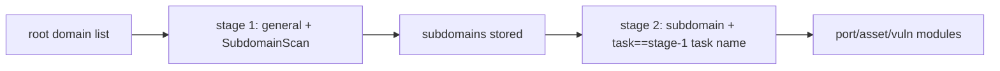

---

## name: scopesentry-mcp
description: Manage the security scanning platform (projects, tasks, templates, assets, nodes) via the ScopeSentry MCP. Use when the user mentions ScopeSentry, MCP, API Key, scan tasks, or asset queries.

# ScopeSentry MCP usage guide

For users with a [deployed ScopeSentry instance]. Connect to the platform via Cursor (or another MCP client); no local source needed.

## 1. Preparation

### 1.1 Confirm the service is reachable

- Default web UI: `http://<host>`
- MCP endpoint: `http://<host>/mcp` (if there is a reverse proxy or frontend proxy in front, use the actual `/mcp` address)

### 1.2 Create an API Key

1. Log in to the ScopeSentry web UI in a browser
2. Go to the [API Key] management page and create a key (or create one via an admin-provided endpoint)
3. Save the returned `ssk_...` string ([shown only once])

### 1.3 Configure Cursor MCP

Cursor -> Settings -> MCP -> add a server:

```json
{
  "mcpServers": {
    "scopesentry": {
      "url": "http://<your-host>:8082/mcp",
      "headers": {
        "X-API-Key": "ssk_your-key"
      }
    }
  }
}
```

You can also use: `Authorization: Bearer ssk_your-key`

After configuring, restart MCP or reload Cursor, and confirm that `list_projects`, `list_assets`, etc. appear in the tool list.

---

## 2. Tool overview


| Tool                     | Purpose             |
| ---------------------- | ----------------- |
| `list_projects`        | project tree grouped by tag (incl. project ID) |
| `list_projects_data`   | paginated project list, searchable by name |
| `get_project`          | project detail      |
| `create_project`       | create a project    |
| `list_tasks`           | scan task list      |
| `get_task`             | task detail         |
| `list_scan_templates`  | scan template list  |
| `get_scan_template`    | template detail     |
| `list_plugin_modules`  | scan pipeline module names |
| `list_plugins`         | available plugins (incl. hash, default params) |
| `create_scan_template` | create a scan template |
| `create_scan_task`     | create a scan task  |
| `list_assets`          | query assets of each kind (paginated list) |
| `count_assets`         | count assets (`/api/assets/common/total`) |
| `get_asset_detail`     | asset or vuln detail |
| `add_asset_tag`        | add a tag to an asset |
| `list_nodes`           | scan node list      |


The parameters of each tool follow the MCP tool description (schema); the search and filter syntax of `list_assets` / `count_assets` is the same, so read the `list_assets` description before querying assets.

When you need to know "how many total", use `count_assets` (the web pagination total endpoint); do not page through `list_assets` repeatedly just to count.

---

## 3. Common workflows

### 3.1 Query assets by project

When the user or context [already has a project condition], prefer adding `filter.project` to narrow the scope and avoid slow responses from too much cross-project data. If no project is specified, you need not force a project filter.

1. `list_projects` or `list_projects_data` to get the target project's [ObjectID] (`id` / `children[].value`)
2. `list_assets` with `filter.project` ([must be an ID, not the project display name])

```json
{
  "asset_type": "asset",
  "pageIndex": 1,
  "pageSize": 20,
  "search": "domain=^example.com",
  "filter": {
    "project": ["<project ObjectID>"]
  }
}
```

### 3.2 Create a scan task

1. `list_nodes` to get online node names
2. `list_scan_templates` or `create_scan_template` to get a template [ObjectID]
3. `create_scan_task`: `name`, `node` required; `template` takes the template ID (not the template name)

[Target source `targetSource` (same as the web UI):]

| targetSource | Description | Required params |
| --- | --- | --- |
| `general` | enter targets directly | `target` |
| `project` | read targets from a project | `project` (array of project ObjectIDs) |
| `asset` | search the web asset store | `search`; optional `project`, `filter`, `targetNumber` |
| `RootDomain` | search the root-domain store | `search`; optional `project`, `filter`, `targetNumber` |
| `subdomain` | search the subdomain store | `search`; optional `project`, `filter`, `targetNumber` |
| `UrlScan` | search URL scan results | `search`; optional `project`, `filter`, `targetNumber` |
| `*Source` (e.g. `subdomainSource`) | create from "selected/searched" on an asset page | with `targetTp=search` use `search`; with `targetTp=select` use `targetIds` |

[Example - scan a root domain directly:]

```json
{
  "name": "example-subdomain-collection",
  "node": ["node-1"],
  "template": "<template ObjectID>",
  "targetSource": "general",
  "target": "example.com\nfoo.com",
  "project": ["<project ObjectID>"]
}
```

[Example - continue scanning from the subdomain store (filter by the previous task name):]

```json
{
  "name": "example-port-and-vuln",
  "node": ["node-1"],
  "template": "<follow-up module template ObjectID>",
  "targetSource": "subdomain",
  "search": "task==\"example-subdomain-collection\"",
  "project": ["<project ObjectID>"]
}
```

### 3.3 Full info gathering from a root domain (two-stage recommended)

When the input is a [root domain] and you want [full info gathering], run two scans rather than the whole pipeline at once.

[Reason:] distributed tasks dispatch per [single target]. When a root domain is a target, the node that gets it also runs the follow-up modules on the subdomains it finds, which causes uneven load, slowness, and errors.

[Best practice:]

1. [Stage 1 - subdomain collection only]
   - `targetSource`: `general`
   - `target`: all root domains (multi-line)
   - Template: enable only `SubdomainScan`, `SubdomainSecurity` (subdomain scan + subdomain takeover)
   - Use `get_task` to wait for the task to finish

2. [Stage 2 - follow-up modules]
   - `targetSource`: `subdomain`
   - `search`: `task=="<stage-1 task name>"` (exact match on the task name)
   - Optional `project` to narrow the scope
   - Template: port scan, asset mapping, vuln scan, etc. (can exclude SubdomainScan)
   - Subdomains dispatch as independent targets to each node, more efficient in parallel

You can also filter by task name on the "Subdomains" asset page in the web UI and use "create task from subdomains"; same effect.



### 3.4 Create a scan template

1. `list_plugin_modules` -> module name list
2. `list_plugins` (filter by `module`) -> each plugin's `hash` and default `parameter`
3. `create_scan_template`: use `modules` to map "module -> plugin hash array"

---

## 4. Asset query (`list_assets` / `count_assets`)

`count_assets` uses the same `asset_type`, `search`, `filter` as `list_assets`, and returns `{ "total": N }`, corresponding to the web-side `/api/assets/common/total`.

```json
{
  "asset_type": "subdomain",
  "search": "task==\"some task name\"",
  "filter": {"project": ["<project ObjectID>"]}
}
```

[Performance tips (`list_assets` / `count_assets` alike):] when there is a project condition, prefer `filter.project` to narrow the scope; in `search`, prefer `==` exact or `^` prefix match on indexed fields (see [4.3](#43-search-expression)), avoiding broad `=` fuzzy queries that slow the response. With no project context, do not force a project filter.

Types that support `filter.project` are in the table in [4.4](#44-filter-exact-filtering).

### 4.1 Asset type `asset_type`

`asset`, `RootDomain`, `subdomain`, `app`, `mp`, `UrlScan`, `SensitiveResult`, `DirScanResult`, `crawler`, `vulnerability`, `PageMonitoring`, `IPAsset`, `SubdomainTakerResult`

Alias examples: `web`->asset, `vuln`->vulnerability, `ip`->IPAsset, `url`->UrlScan

### 4.2 Parameter notes


| Parameter                | Description                               |
| ------------------------ | --------------------------------------- |
| `pageIndex` / `pageSize` | pagination, default 1 / 20              |
| `search`                 | search expression (see next section)    |
| `filter`                 | exact filter JSON (see next section)    |
| `sort`                   | only UrlScan, DirScanResult support sorting by `length` |
| `sid`                    | SensitiveResult only: sensitive rule name |


`search` and `filter` [can be used together].

### 4.3 search expression

A custom DSL ([not SQL]):


| Operator  | Meaning   | Index | Example                     |
| ---- | ---- | ---- | --------------------------- |
| `=`  | fuzzy match (regex) | no index | `domain=example`            |
| `==` | exact match (equals) | **uses index** | `port==443`                 |
| `!=` | exclude   | — | `port!="80"`                |
| `&&` | and    | — | `domain==example.com && port==443` |
| `||` | or    | — | `title=admin || body=login` |


[Index and operators:] fields like `domain`, `ip`, `port`, `title` are indexed, but only [`==` exact] or [a value starting with `^` prefix match] (e.g. `domain=^example.com`) use the index; [`=` becomes a regex fuzzy match and cannot use the index], so it gets slow on large data.

[search fields common to all types:] `tag`, `task` (task name), `rootDomain`

[`project` cannot be written in search] (invalid, or errors when combined with `&&`). To filter by project, use `filter.project`.

[Common search fields per type:]


| asset_type           | Fields                                                                               |
| -------------------- | ----------------------------------------------------------------------------------- |
| asset                | domain, ip, port, service, app, title, statuscode, icon, banner, type, body, header |
| RootDomain           | domain, icp, company                                                                |
| subdomain            | domain, ip, type, value                                                             |
| app                  | name, icp, company, category, description, url, apk                                 |
| mp                   | name, icp, company, category, description, url                                      |
| UrlScan              | url, input, source, resultId, type                                                  |
| SensitiveResult      | url, sname, body, info, md5                                                         |
| DirScanResult        | url, statuscode, redirect, length                                                   |
| vulnerability        | url, vulname, matched, request, response, level                                     |
| crawler              | url, method, body, resultId                                                         |
| PageMonitoring       | url, hash, diff, response                                                           |
| IPAsset              | ip, domain, port, service, webServer, app                                           |
| SubdomainTakerResult | domain, value, type, response                                                       |


[search examples:]

- `domain==www.example.com && port==443` (exact, uses index)
- `domain=^example.com` (prefix match, uses index)
- `ip==192.168.1.1`
- `task=="some task name"`
- `level==high` (vulnerability)
- `statuscode==200` (DirScanResult)

When you need a fuzzy contains, use `=`, e.g. `title=admin` (no index, best combined with a project or other condition to narrow the scope).

### 4.4 filter exact filtering

A JSON object: multiple values for the same key are [OR], different keys are [AND].

[Prefer `project` when there is a project condition:] if the user or context has an explicit project and the asset_type supports `project`, add it to narrow the scope; do not force it when there is no project info.


| filter key   | Meaning    | Value notes                                                |
| ------------ | -------- | -------------------------------------------------------- |
| `project`    | owning project | [ObjectID], get via `list_projects` / `list_projects_data` |
| `task`       | source task | [task name], via the `name` from `list_tasks`            |
| `port`       | port     | e.g. `"443"`                                             |
| `service`    | service/protocol | e.g. `"https"`                                           |
| `app`        | app fingerprint | e.g. `"Nginx"`                                           |
| `icon`       | icon hash |                                                          |
| `statuscode` | HTTP status code | mainly for asset                                         |
| `status`     | status   | UrlScan/DirScan HTTP code; vuln/sensitive processing status |
| `level`      | vuln level | critical / high / medium / low / info                    |
| `type`       | type     | e.g. subdomain record type A, CNAME                      |
| `color`      | sensitive rule color | SensitiveResult                                          |
| `sname`      | sensitive rule name | SensitiveResult                                          |
| `tags`       | tags     |                                                          |


[Available filter keys per type:]


| asset_type                            | filter key                                                      |
| ------------------------------------- | --------------------------------------------------------------- |
| asset                                 | project, port, service, app, icon, statuscode, type, task, tags |
| RootDomain                            | project, tags                                                   |
| subdomain                             | project, type, task, tags                                       |
| app / mp                              | project, tags                                                   |
| UrlScan                               | status, tags                                                    |
| DirScanResult                         | status, tags                                                    |
| SensitiveResult                       | status, color, sname, tags                                      |
| crawler                               | project, task, tags                                             |
| vulnerability                         | project, level, status, task, tags                              |
| PageMonitoring / SubdomainTakerResult | tags                                                            |
| IPAsset                               | project, port, service, app                                     |


[filter example:]

```json
{"project": ["<project ObjectID>"], "port": ["443"]}
```

[Combined query example:]

```json
{
  "asset_type": "asset",
  "search": "domain=^baidu && port==443",
  "filter": {"project": ["<project ObjectID>"]},
  "pageIndex": 1,
  "pageSize": 10
}
```

[Notes:]

- Prefer `filter.project` when there is a project condition (if supported); not forced without project context
- Do not put the project display name in `filter.project`
- Use `==` for known values, `^` for a prefix; avoid overusing `=` fuzzy match on large tables
- For UrlScan HTTP status use `filter.status`; for DirScanResult you can use `statuscode==200` in search
- For SensitiveResult by rule name: use `sname=rule name` in `search`, or `filter.sname`

### 4.5 Sort (sort)

Only [UrlScan] and [DirScanResult] support it:

```json
{"length": "ascending"}
```

Other types ignore `sort` and sort by time by default.

---

## 5. Scan template module names

`TargetHandler`, `SubdomainScan`, `SubdomainSecurity`, `PortScanPreparation`, `PortScan`, `PortFingerprint`, `AssetMapping`, `AssetHandle`, `URLScan`, `WebCrawler`, `URLSecurity`, `DirScan`, `VulnerabilityScan`, `PassiveScan`

---

## 6. Troubleshooting


| Symptom     | Fix                                                |
| --------- | -------------------------------------------------- |
| MCP has no tools | check URL, API Key, and whether ScopeSentry is running |
| 401 / 403 | recreate or replace the API Key                    |
| assets not found | confirm `filter.project` is an ObjectID; do not write project in search |
| template/task creation fails | `template` must be a template ObjectID; `node` takes an online node name |
| query slow/stuck | add `filter.project` when there is a project; use `==` or `^` prefix on indexed fields in search, avoid `=`; reduce `pageSize` |


---
